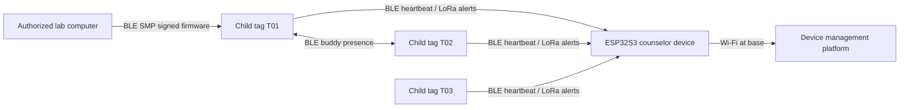
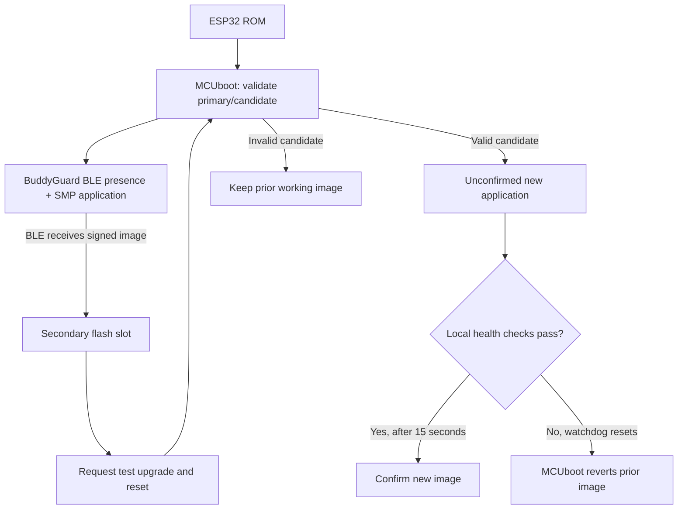

# BuddyGuard — ESE 5180 Team 02

**Paused 2026-10-29:** BLE and signed-update tests passed; LoRa has not passed SPI readback or RF communication. Both devices currently run confirmed 1.1.4. The source is a development candidate. Resume from [the checkpoint](docs/PAUSED-2026-10-29.md).

**Team:** Jet2Holiday

**Repository:** https://github.com/ese5180/f26-t02-wearable-buddy-system

| Member | Email |
|---|---|
| Siwei Lei | laialex@engineering.upenn.edu |
| Rico Zhuang | zzhuan13@engineering.upenn.edu |
| Yunzhe Deng | deng1@engineering.upenn.edu |
| Yubin Guan | guan1@engineering.upenn.edu |

## Current concept

BuddyGuard is a camp group-supervision prototype. Wearable tags send BLE presence heartbeats; a counselor device maintains a local roster. Paired tags can provide an additional buddy check. LoRa P2P carries alerts and roll-call responses when BLE contact is lost. Wi-Fi supports device management at base.

The previous AI-agent console concept is retained in [the archive](docs/archive/README-before-buddyguard.md). It is not the current hardware or product specification.



This diagram describes the product architecture. The validation table below distinguishes completed work from planned work.

## Hardware baseline

| Role | Part | Interface |
|---|---|---|
| MCU | Seeed XIAO ESP32S3, kit SKU 102010611 | USB for provisioning/logs; built-in BLE/Wi-Fi |
| Long-range radio | Wio-SX1262, ESP32S3 B2B version | SPI + control GPIOs; 915 MHz antenna |
| Motion sensor | Adafruit 4503, LSM6DS3TR-C; course stock | I2C |
| Haptic driver | Adafruit 2305, DRV2605L | I2C, ERM configuration |
| Vibration motor | Adafruit 1201 | DRV2605L motor terminals |
| Clasp input | Adafruit 375 | GPIO |
| GNSS, later integration | Seeed L76K 109100021 | UART |

The radio and MCU use separate LoRa and 2.4 GHz antennas. The first implementation uses a serial console. The final BOM is [here](https://docs.google.com/spreadsheets/d/1GG7O95_0aSs89AQl4g6phD0VFDLTcqFAaMB5zflHOEA/edit?gid=2071228825#gid=2071228825).

## Current implementation and verification

| Feature | Status |
|---|---|
| Zephyr build, USB provisioning, serial logs | Verified on two XIAO ESP32S3 + Wio-SX1262 B2B kits |
| MCUboot ECDSA-P256, primary-image validation, move-based swap | Verified through successful, rejected and reverted BLE updates |
| BLE presence advertisement, increasing sequence number | Verified by a Mac BLE scan |
| BLE SMP image-state query | Verified before/after updates; host never confirms the image |
| Signed BLE updates | 1.0.0 → 1.1.0 → 1.1.1 → 1.1.3 → 1.1.4 verified; current source version is 1.1.7 |
| Wrong-key and corrupted-image rejection | Full BLE transfers completed; confirmed primary retained after reboot |
| Unconfirmed-image failure/revert | Signed 1.2.0 fault image booted, watchdog reset it, MCUboot restored 1.1.1 |
| Interrupted upload/resume | Valid transfer stopped at 20%; old primary retained; resumed at the same byte offset |
| Counselor BLE roster | C01 observed T01; 8-second laboratory timeout with maintenance grace |
| LoRa status, SOS, ACK/retries and roll call | Implemented but unverified; SPI readback fails, no valid RF ACK received |
| Child-to-child buddy pairing | Planned; current bench setup is one tag and one counselor |
| IMU, vibration, clasp and GNSS integration | Not enabled in this firmware stage |
| Wi-Fi/cloud integration | Not enabled in this firmware stage |

## Reproducible development environment

- Board target: `xiao_esp32s3/esp32s3/procpu`.
- Zephyr revision is pinned by `west.yml`: `f80761e49401497b5ee64ee9732dc2791055ec52`.
- Verified local toolchain: Zephyr SDK 1.0.1, west 1.5.0, Python 3.12.
- The checkout reports Zephyr 4.4.99; it is a pinned development revision, not a tagged stable release.
- Use source/build directories without spaces with the currently installed toolchain.

For a new workspace, install the Zephyr prerequisites and SDK using the [official getting-started guide](https://docs.zephyrproject.org/latest/develop/getting_started/index.html), clone this repository as `buddyguard`, then run `west init -l buddyguard`, `west update`, and `west blobs fetch hal_espressif` from its parent workspace. The ESP32 Bluetooth CMake dependency check currently expects the module's complete blob set.

The local setup used here is `/Users/guan/zephyrproject`, with west in `.venv/bin/west`. Set `BUDDYGUARD_ZEPHYR_WORKSPACE` when using another path; `scripts/build.py` expects that workspace's `.venv/bin/west`.

### Signing keys

The repository includes only `keys/team2-signing-public.pem`. The team private key stays outside the repository. On the initial development Mac its path is `~/.config/buddyguard/team2-signing/firmware-ecdsa-p256.pem` with mode 0600.

Other members need the same team development signing identity through a controlled channel, or signed artifacts from the signing workstation. Do not generate unrelated per-member roots for the same devices. The default public-only key configuration deliberately cannot sign a release; the build script supplies the external private-key path.

```sh
/path/to/zephyr-workspace/.venv/bin/python scripts/build.py --build-dir /path/without/spaces/build-buddyguard
# Counselor: add --counselor, using a separate build directory.
# Test version: add --version 1.1.4; fault injection: add --fault in a test build.
```

The private key never becomes part of the application or bootloader. Hardware Secure Boot eFuses and flash encryption have not been enabled.

### Host tools

```sh
python3 -m venv .venv
.venv/bin/python -m pip install -r requirements-host.txt
.venv/bin/python -m unittest discover -s tests -v
```

On macOS, allow Bluetooth access for the host process when prompted. Host tools filter discovery to BuddyGuard tags.

```sh
.venv/bin/python tools/bg_ble.py scan --seconds 10
.venv/bin/python tools/bg_ble.py images
.venv/bin/python tools/bg_serial.py command bg status
.venv/bin/python tools/bg_serial.py command bg maintenance 300
```

With multiple USB boards connected, specify `tools/bg_serial.py --port /dev/cu.YOUR_PORT ...` explicitly.

### Initial USB installation

`scripts/flash_initial.py` is for first provisioning. It verifies an existing full-flash backup, reads the MCUboot/application addresses from their generated runner files, erases the development board, and writes both images in one esptool operation. Run it using the Zephyr Python environment, which supplies esptool and PyYAML. `--backup-info` must refer to a size/hash-verified backup of that board.

Use BLE for update testing after the initial installation. Do not run initial provisioning between the before/after observations of an OTA test.

## Wireless presence protocol

The advertisement contains the standard SMP service UUID and an 8-byte laboratory manufacturer-data payload. Its 0xffff company ID is a development placeholder.

| Field | Bytes | Meaning |
|---|---:|---|
| Company ID | 2 | 0xffff, little endian; Bleak strips this prefix |
| Protocol | 1 | 1 |
| Tag | 1 | Laboratory tag ID |
| Sequence | 2 | Little endian, increments every 2 seconds |
| Flags | 1 | bit0 maintenance, bit1 unconfirmed image |
| Role | 1 | 1 = tag, 2 = counselor |

The normal heartbeat frame contains no child name or coordinates. The current controller identity is not rotated; rotating IDs and link access control remain future security work.

A laboratory maintenance window is open for the first 300 seconds after boot. `bg maintenance 300` reopens it; `bg maintenance 0` closes admission. New BLE connections are accepted only during that window. An existing connection is allowed to finish its transfer. The lab SMP service is unauthenticated; signed-image validation is implemented separately. This is not yet a deployment access-control design.

`bg heartbeat off` stops advertisements for loss-detection experiments; `bg heartbeat on` restores them. During an SMP connection, presence advertisements pause. A counselor must treat the updating tag as under maintenance.

The counselor passively scans tags T01–T03 and counts only a changed sequence as fresh presence. In normal mode it reports missing after 8 seconds and requests a LoRa status; a fresh BLE sequence reports recovery. If the last frame announced maintenance, the timeout is 120 seconds. This is a bounded grace period, so long uploads may still produce a warning. Tags never observed are not considered online.

## LoRa P2P protocol

Both roles use 915 MHz, SF7, 125 kHz bandwidth, coding rate 4/5, an 8-symbol preamble, private-network mode and 4 dBm transmit power, through Zephyr's LoRaMac-node backend. The SX1262 is connected through the ESP32S3 kit's B2B connector: SCK=7, MOSI=9, MISO=8, NSS=41, RESET=42, BUSY=40, DIO1=39, antenna enable=38. The overlay specifies the DIO2 RF switch and 3 V TCXO; the application explicitly selects LDO after each modem configuration because this backend ignores `regulator-ldo`. Startup reads back the private sync word (0x1424) and refuses to confirm if SPI readback fails.

For the pinned Zephyr revision, `app.overlay` also maps `gpio1` to the shared GPIO register-block base. That revision's GPIO driver accesses `out1`/`in1` through a full `gpio_dev_t`, while the upstream high-port node uses a base offset of 0x800. The override is a candidate workaround for that driver/devicetree mismatch; the actual radio still returned 0xffff after it was applied. It did not resolve the link. Re-evaluate it when changing Zephyr revisions.

Frames are 12 bytes: `BG`, protocol, type, tag, flags, little-endian sequence, motion, clasp and little-endian battery millivolts. Types are STATUS=1, ACK=2, SOS=3, QUERY=4, REPLY=5. Tags send status about every 10 seconds. STATUS/SOS/REPLY use a 600 ms ACK window and up to three attempts; the counselor acknowledges repeated events while suppressing repeated action logs. `bg sos` queues a tag alert; `bg query 1` requests T01's response.

Motion and clasp are UNKNOWN and battery is unavailable (0xffff) until their hardware is integrated. Counselor logs include tag ID, event, sequence, RSSI and SNR. A LoRa response indicates radio reachability, not the child's location. The current laboratory frames are not encrypted or authenticated.

## Wireless Demo & Secure Firmware Updates

### Boot and update flow



Startup checks Flash availability, radio SPI readback and initialization, Bluetooth initialization, and the role's roster startup. The healthy advertisement loop feeds an 8-second watchdog. A newly tested image confirms after 15 seconds of healthy execution. No Internet connection, peer response or GNSS fix is required for confirmation. `firmware/conf/fault.conf` deliberately stops watchdog feeding before confirmation to exercise rollback.

### Flash map and sizes

The physical board has an off-chip 8 MB SPI Flash. This prototype retains the upstream board's lower-4-MB AMP partition layout; the second CPU is not used by this application.

| Region | Offset | Allocated size |
|---|---:|---:|
| MCUboot | 0x000000 | 0x10000 / 64 KiB |
| System reservation | 0x010000 | 0x10000 / 64 KiB |
| Primary image | 0x020000 | 0x150000 / 1,344 KiB |
| Secondary image | 0x170000 | 0x150000 / 1,344 KiB |

Additional upstream reservations follow these regions; see generated `zephyr.dts` for the complete map. Header/trailer and move-swap overhead reduce usable application space. Whether this onboard off-chip Flash satisfies the course external-flash exercise still needs teaching-team confirmation.

Measured v1.0.0 binary sizes: MCUboot **46,672 bytes**, application before MCUboot signing **432,468 bytes**, signed file **432,618 bytes**. The esptool write aligns the latter to a four-byte boundary. Binary size is distinct from allocated partition capacity and RAM usage.

The rejected 1.1.7 bring-up candidates had signed application sizes of **434,940 bytes (tag)** and **435,324 bytes (counselor)**; their bootloader builds remain **46,672 bytes**. File hashes and unsigned sizes are recorded in [current-builds.json](evidence/current-builds.json).

### Update procedure

```sh
.venv/bin/python tools/bg_serial.py command bg maintenance 300
.venv/bin/python tools/bg_ble.py images
.venv/bin/python tools/bg_ble.py update /path/to/new/zephyr.signed.bin
```

The update client uploads using the existing smpclient implementation, requests a test upgrade with `confirm=False`, and resets the device. It does not remotely confirm the new image. Read serial logs and query image states after the application's health check to verify the result.

The default SMP packet limit is 244 bytes; expect several minutes for the approximately 435 KB application. Upload transport failures reconnect up to three times and resume the same file by SHA. To demonstrate interruption deliberately, run `upload IMAGE --stop-at 20`, verify the old primary is still active, then `update IMAGE` using exactly the same file. Use `--name BG-C01` before the command to select the counselor. The shared signing root does not enforce role matching; select the correct role artifact.

### Course questions

1. **Bootloader size:** measured above; report the final build separately if its configuration changes.
2. **Application size:** measured above; includes the wireless application and SMP server.
3. **Downloader:** the application receives BLE SMP packets and writes the secondary slot; MCUboot verifies and activates at boot.
4. **Wireless transport:** BLE, supported directly by each tag and a nearby host; no LoRa firmware relay is needed for this milestone.
5. **Storage:** secondary partition of the onboard off-chip SPI Flash, at the generated address above.
6. **Failure handling:** signature/hash verification, retained previous image, test/revert, delayed confirmation and watchdog. Actual test outcomes must be recorded; a successful build alone does not prove recovery.

### Validation record

See [hardware validation](evidence/validation.md) for observed versions, rejection/rollback results and selected logs, and the [demo runbook](docs/demo-runbook.md) for the two-board procedure. Raw build/device captures and generated binaries are ignored by Git. The public verification key may be committed; private keys and credentials may not.

## Remaining product work

- Child-to-child buddy pairing, using an additional tag.
- Outdoor BLE/LoRa range and reliability measurements; the bench test does not establish a separation distance.
- External IMU, DRV2605L vibration and clasp inputs; GNSS after basic links are stable.
- Wi-Fi and the approved device-management platform, deferred by the team while BLE/LoRa/FOTA are completed.
- Management authorization, authenticated business messages, replay protection and rotating session IDs.
- Four-member clean builds, final checkoff rehearsal and submission to GitHub/Gradescope before requesting checkoff.

Course references: [assignment](https://docs.google.com/document/d/1gKqiMN2WEVwAf0uwNyS8Gh1MBPQqg_3FwDCZpiu_ctY/edit?tab=t.0), [Zephyr MCUboot signing](https://docs.zephyrproject.org/latest/build/signing/index.html), [MCUboot design](https://docs.mcuboot.com/design.html), [SMP sample](https://docs.zephyrproject.org/latest/samples/subsys/mgmt/mcumgr/smp_svr/README.html).
