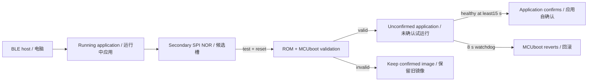

# BuddyGuard — ESE 5180 Team 2

**BLE presence + LoRa P2P + signed BLE updates + MCUboot UART recovery**, on the XIAO ESP32S3 / Wio-SX1262 B2B kit.

**营地标签与辅导员监测原型**：BLE 通信心跳、LoRa P2P 查询／告警、MCUboot 签名 BLE 更新及 UART 恢复。

## Start here / 文档入口

| Document | 中文 | English |
|---|---|---|
| Teammate setup, build, provisioning, wireless demo, OTA and troubleshooting / 队友完整复现 | [操作文档](docs/zh/GETTING_STARTED.md) | [Reproduction guide](docs/en/GETTING_STARTED.md) |
| Module interfaces, threads, radio formats, update chain and limits / 固件解释 | [固件解释](docs/zh/FIRMWARE.md) | [Firmware explanation](docs/en/FIRMWARE.md) |
| Firmware security checkoff + UART extra credit / 安全作业回答与加分实现 | [中文回答](docs/zh/FIRMWARE_SECURITY_CHECKOFF.md) | [English answer](docs/en/FIRMWARE_SECURITY_CHECKOFF.md) |
| MCUboot UART recovery / 串口恢复加分实现 | [恢复操作](docs/zh/UART_RECOVERY.md) | [UART recovery](docs/en/UART_RECOVERY.md) |
| Wireless retry, regression and learning / 无线重试、回归与学习 | [中文](docs/zh/WIRELESS_RELIABILITY.md) | [English](docs/en/WIRELESS_RELIABILITY.md) |
| Next cloud-management stage / 下一阶段云端管理 | [中文](docs/zh/NEXT_STEPS.md) | [English](docs/en/NEXT_STEPS.md) |
| Optional SparkFun LSM6DSO / 可选 IMU | [IMU 接入](docs/zh/IMU_LSM6DSO.md) | [IMU integration](docs/en/IMU_LSM6DSO.md) |
| Observed build and hardware results / 实测结果 | [Validation record](evidence/validation.md) | [Current build metadata](evidence/current-builds.json) |

Current source: **1.1.20**. Both roles have been BLE-updated and self-confirmed. LoRa retry timing and recent-duplicate history are now hardware-independent modules; the single radio worker dispatches other packets while a transaction waits. QUERY has bounded retries and expects a matching REPLY. See the [source learning map](firmware/README.md), bilingual reliability guide and dated validation.

当前源码 **1.1.20**，两端已完成 BLE 更新和自确认。LoRa 重试时序、近期去重已拆成无硬件依赖的独立模块；唯一无线线程在等待事务时仍分发其他帧，QUERY 有有限重试并等待同序号 REPLY。学习入口见 [firmware/README.md](firmware/README.md)。审核期间使用 `codex/buddyguard-wireless-fota` 分支。

Earlier C01 1.1.19 passed MCUboot UART signed recovery and wrong-key rejection; [dated UART evidence](evidence/uart-recovery-20261031.md). The installed bootloaders are retained during the current BLE application updates. An external TTL cable is not needed for this round.

此前 C01 1.1.19 已通过 MCUboot UART 签名恢复与错误密钥拒绝；本轮 BLE 只更新应用，保留既有 bootloader，无需外接 TTL 线。

Latest / 最新实测：[1.1.20 BLE FOTA and wireless validation / 回归记录](evidence/wireless-fota-v1120-20261031.md). Five-minute normal run:20/20 queries,8/8 SOS, no unexpected reset/missing/queue drops; retries occurred.

## Repository layout / 目录

```text
firmware/
  src/main.c          startup and service loop / 启动与主循环
  src/ble/            presence and maintenance / 广播与维护窗口
  src/roster/         counselor presence state / 辅导员名单
  src/radio/          hardware owner + pure retry/history / 收发线程＋独立重试与去重
  src/drivers/        Wio-SX1262 hardware / 硬件配置与收发
  src/sensors/        optional IMU worker / 可选传感器采样
  src/protocol/       wire codec and motion classifier / 协议与运动分类
  src/platform/       watchdog and image health / 看门狗与镜像确认
  src/console/        USB shell / 串口命令
  include/            service interfaces / 模块接口
scripts/              role-aware builds, backup, initial USB provisioning
                      分角色构建、整片备份、首次烧录
tools/                BLE SMP and serial host clients / 电脑端工具
tests/                host decoder + native firmware protocol tests
                      电脑解码与固件协议测试
docs/en/ docs/zh/      complete bilingual guides / 完整中英文文档
evidence/             curated validation and hashes / 验证摘要与哈希
keys/                 public verification key only / 仅公钥
west.yml              pinned Zephyr + imported modules / 固定依赖
```

Use workspace/source/build/key paths **without spaces**. The pinned board is `xiao_esp32s3/esp32s3/procpu`; Zephyr revision `f80761e49401497b5ee64ee9732dc2791055ec52`, SDK 1.0.1, west 1.5.0, Python 3.12. A new teammate should follow the complete guide rather than reuse another machine's absolute paths. `scripts/build.py --help` lists role, tag ID, workspace, key and isolated-version options.

源码／工作区／构建／密钥路径**不能带空格**。新队友请按完整操作文档建立自己的环境；脚本支持独立工作区与 T01–T03 配置，无需沿用开发 Mac 的绝对路径。

## Scope / 当前范围

The bench uses one tag and one counselor. Implemented: BLE presence/roster, LoRa STATUS/SOS/ACK/QUERY/REPLY, serial controls, signed BLE test updates and optional SparkFun LSM6DSO sensing (`--imu` on tags). Planned child-to-child pairing, clasp/motor/GNSS/battery readings and Wi-Fi/cloud are **not implemented** here. Motion is UNKNOWN without valid enabled sensing; clasp is UNKNOWN and battery unavailable. LoRa transactions have finite retries and dispatch other packets while waiting; half-duplex transmission, synchronous receive windows and finite queues still permit loss. No location/distance estimate is produced.

目前实测为一标签＋一辅导员。已实现 BLE 名单、LoRa 消息、串口控制、签名更新和可选 LSM6DSO 运动采样（标签 `--imu`）；儿童配对、其余外设及 Wi-Fi／云尚未接入。QUERY 已有有限重试，等待时继续分发其他帧；半双工发送、同步接收窗口及有限队列仍可能丢包，不输出位置／距离。

MCUboot authenticates signed application images. Hardware secure-boot eFuses/flash encryption are not enabled; BLE SMP is unpaired, radio business frames are unauthenticated, and identifiers are static. Shared signing keys do not prevent selecting the wrong role image. This is a laboratory prototype, not validated child-safety equipment.

MCUboot 验证应用签名；尚未开启硬件 secure boot／Flash 加密，管理接入与业务帧认证尚待完成，ID 仍为静态。共用签名根不能防止刷错角色。本项目目前为实验原型。

## Firmware security checkoff / 安全验收摘要

| Question / 问题 | Current implementation / 当前实现 |
|---|---|
| Bootloader size / 引导程序 | T01:46,672 B; C01 with UART recovery:63,728 B. Existing bootloaders retained in this BLE regression / 本轮未重刷bootloader |
| Application size / 应用 | T01 unsigned436,948 B / signed437,099 B; C01 unsigned435,748 B / signed435,899 B |
| Who downloads? / 谁负责下载？ | Running Zephyr application receives BLE SMP and writes secondary; MCUboot validates/activates at boot / 应用收包，启动时验签激活 |
| Wireless method / 无线方式 | BLE SMP; no AP/cloud needed for local updates; LoRa remains the supervision channel / BLE负责更新，LoRa负责监督消息 |
| Storage / 存储 | On-board8 MiB external SPI NOR; primary0x20000, secondary0x170000; each slot0x150000 bytes / 板载独立SPI NOR，未另接第二个Flash模块 |
| Signing / 签名 | Unique Team2 ECDSA-P256 identity, private key outside Git / 团队独有密钥，Git中仅公钥 |
| Invalid images / 无效镜像 | Full BLE wrong-key1.3.2 and corrupted1.4.1 uploads were rejected after reset; confirmed1.1.20 retained / 复位拒绝并保留原版本 |
| Valid signature, faulty code / 有效签名但代码故障 | Signed1.2.2 trial booted unconfirmed, stopped WDT feeds, watchdog-reset and reverted to confirmed1.1.20 / 实际故障启动后回滚 |
| Interrupted transfer / 传输中断 | Paused at87,258 bytes; original primary stayed active/confirmed; same signed file resumed from87,258 / 同文件断点续传 |
| Extra credit / 加分 | Earlier C01 MCUboot UART signed recovery/rejection passed on1.1.19; [UART record](evidence/uart-recovery-20261031.md). No external TTL connected in this BLE run / 本轮未重测外接UART |



Sizes are binary-file sizes, not partition allocation/RAM. A health gate does not prove every business function. Hardware secure-boot eFuses/Flash encryption are disabled. Physical management authorization and anti-downgrade remain pending. Confirm with Nick whether the on-board off-chip Flash meets the course's external-storage interpretation; no second Flash module is claimed. Complete [English answers](docs/en/FIRMWARE_SECURITY_CHECKOFF.md) / [中文回答](docs/zh/FIRMWARE_SECURITY_CHECKOFF.md) explain the limits and dated evidence.

文件大小不是分区容量或RAM；健康自确认不等于完整业务验收。外部Flash口径仍需教学团队确认。每位队友独立构建／烧录及Gradescope提交尚未由本机验证；请求checkoff前请完成这些交付。云端项目尚未建立，见[下一阶段](docs/zh/NEXT_STEPS.md)。

## Files kept local / 留在本机的文件

Do not commit private keys, full-flash backups, credentials, `.venv`, build directories, signed artifacts or raw captures. The public verification key and curated non-secret evidence are included. Existing boards require the original team signing identity; the guides explain new-board provisioning separately.

私钥、整片备份、凭据、环境、构建、签名镜像及原始抓取不上传。已有板子必须使用原团队签名身份；新板首次安装有单独流程。

## Project references / 项目材料

- [Current BOM / 硬件清单](https://docs.google.com/spreadsheets/d/1GG7O95_0aSs89AQl4g6phD0VFDLTcqFAaMB5zflHOEA/edit?gid=2071228825#gid=2071228825)
- [Wireless demo assignment / 课程题目](https://docs.google.com/document/d/1gKqiMN2WEVwAf0uwNyS8Gh1MBPQqg_3FwDCZpiu_ctY/edit)
- [Hardware review / 硬件复核](docs/REVIEW-2026-10-30.md)
- [Pre-refactor README / 重构前记录](docs/archive/README-before-modularization.md)
- [Earlier concept / 旧概念归档](docs/archive/README-before-buddyguard.md)

Root `README.pdf` and `image/` are original course-history artifacts, not generated copies of the current firmware documentation. The ordinary hardware-SPI build needs no patch. Optional UART recovery applies the tracked MCUboot threading prerequisite automatically; the older software-SPI diagnostic patch remains historical.

根目录 `README.pdf`、`image/` 为早期课程材料，不是当前文档导出；普通硬件 SPI 不需补丁；可选 UART 恢复由脚本自动应用 MCUboot 线程修复，旧软件 SPI 补丁仍仅供历史诊断参考。

Team Jet2Holiday: Siwei Lei, Rico Zhuang, Yunzhe Deng, Yubin Guan.
