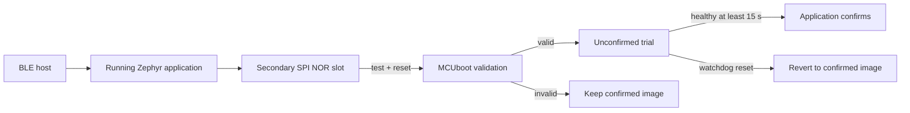

# BuddyGuard — ESE 5180 Team 2

XIAO ESP32S3 + Wio-SX1262 B2B kit · Zephyr · MCUboot · **1.1.20**

BLE communication heartbeat, counselor roster, LoRa P2P alerts/queries, signed BLE updates and optional UART recovery. The tag can use a SparkFun LSM6DSO for motion context.

BLE 通信心跳、辅导员名单、LoRa P2P 告警／查询、签名 BLE 更新及可选 UART 恢复；标签可接 SparkFun LSM6DSO 提供运动状态。

## Start here / 从这里开始

| Purpose / 用途 | 中文 | English |
|---|---|---|
| Clone → environment → build → flash → demo / 队友完整复现 | [操作指南](docs/zh/GETTING_STARTED.md) | [Getting started](docs/en/GETTING_STARTED.md) |
| Module ownership, data flow, protocol and boot chain / 理解固件 | [固件解释](docs/zh/FIRMWARE.md) | [Firmware explanation](docs/en/FIRMWARE.md) |
| Course security questions / 安全作业回答 | [安全验收](docs/zh/FIRMWARE_SECURITY_CHECKOFF.md) | [Security checkoff](docs/en/FIRMWARE_SECURITY_CHECKOFF.md) |
| Optional sensor wiring / 可选传感器 | [IMU 接入](docs/zh/IMU_LSM6DSO.md) | [IMU integration](docs/en/IMU_LSM6DSO.md) |
| Optional bootloader failsafe / 可选加分功能 | [UART 恢复](docs/zh/UART_RECOVERY.md) | [UART recovery](docs/en/UART_RECOVERY.md) |

Read [the source map](firmware/README.md) before individual modules. A compact [validation summary / 实测摘要](docs/VALIDATION.md) distinguishes observed results from planned features.

先看[源码导航](firmware/README.md)，再读模块接口与实现。仓库只保留复现所需内容；历史测试程序、长日志与旧概念材料保留在维护者本地归档和 Git 历史中，不影响当前构建。

## Repository / 目录

```text
firmware/       product modules, interfaces, board and MCUboot configuration
                固件模块、接口、硬件与引导配置
scripts/        signed builds, full backup, initial provisioning, recovery install
                签名构建、备份、首次安装、恢复引导安装
tools/          host-side BLE, USB shell and UART recovery clients
                电脑端 BLE、USB 命令及 UART 恢复工具
docs/en/ zh/    reproduction and explanation, optional guides kept separate
                双语操作／解释文档，可选内容单列
keys/           public verification key only / 仅公钥
patches/        required MCUboot UART prerequisite / 必要的 UART 修复
west.yml        pinned Zephyr and imported dependencies / 固定依赖版本
```

Native macOS remains the documented environment. Use Python 3.12, west 1.5.0, SDK 1.0.1 and the pinned Zephyr revision; keep source/workspace/build/key paths **without spaces**. USB flashing and BLE tools run on the host. No Docker setup is required.

目前沿用原生 macOS 环境，不新增 Docker。队友请按操作指南安装固定版本；已有板子的更新必须使用原团队签名身份，私钥通过团队私下渠道提供。私钥、整片备份、构建产物、虚拟环境和原始日志不上传。

## Firmware security / 固件安全



| Question / 问题 | Answer / 当前实现 |
|---|---|
| Bootloader size / 引导大小 | T01: 46,672 B; C01 with UART recovery: 63,728 B |
| Application size / 应用大小 | T01: 436,948 B unsigned / 437,099 B signed; C01: 435,748 / 435,899 B |
| Download handler / 下载方 | Application receives BLE SMP; MCUboot validates and activates at boot / 应用下载，引导验签激活 |
| Transport / 传输 | BLE for nearby maintenance without AP/cloud; LoRa for supervision / BLE 本地更新，LoRa 监督消息 |
| Storage / 存储 | On-board external SPI NOR: primary `0x20000`, secondary `0x170000`, each `0x150000` B |
| Failure handling / 故障处理 | Unique ECDSA-P256 signing, hash validation, secondary staging/resume, test boot, delayed confirmation, watchdog/revert |
| Extra credit / 加分 | MCUboot UART signed recovery and invalid-signature rejection demonstrated on C01 1.1.19 |

Sizes are recorded binary-file sizes, not partition allocation or RAM. The boot Flash is external to the MCU; no second storage module is fitted. Confirm the course's external-storage interpretation with Nick. Full answers and reproduction commands are linked above.

## Scope and next work / 范围与下一步

Validated on **one tag + one counselor**; T01–T03 are configurable. Child-to-child pairing, a complete three-tag deployment, clasp/motor/GNSS/battery sensing and Wi-Fi/cloud are pending. No cloud project has been created. Next steps are teammate reproduction, additional-tag/field tests and then course cloud integration.

已验证一标签＋一辅导员；儿童间配对、三标签完整并发及其余外设仍待实现。运动缺失／过期报 UNKNOWN；没有测量距离或位置。下一步先完成队友独立复现及多标签／现场验证，再接课程云平台。

MCUboot enforces application signatures. Hardware secure-boot eFuses, Flash encryption, management authorization and radio authentication are not enabled; IDs are static. This is a laboratory prototype with the limits described in the firmware guide.

MCUboot 已验证应用签名；硬件启动锁定、Flash 加密、管理授权与业务帧认证尚未启用，ID 仍为静态。目前是实验原型。

[Current BOM / 硬件清单](https://docs.google.com/spreadsheets/d/1GG7O95_0aSs89AQl4g6phD0VFDLTcqFAaMB5zflHOEA/edit?gid=2071228825#gid=2071228825) · [Course assignment / 课程题目](https://docs.google.com/document/d/1gKqiMN2WEVwAf0uwNyS8Gh1MBPQqg_3FwDCZpiu_ctY/edit)

Team 2: Siwei Lei, Rico Zhuang, Yunzhe Deng, Yubin Guan.
