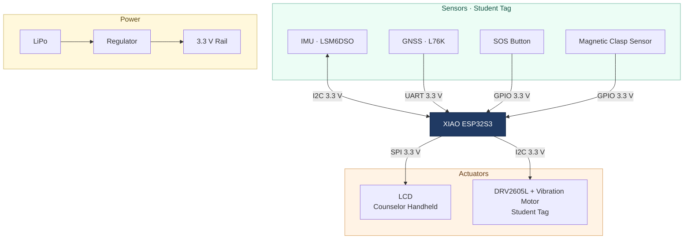
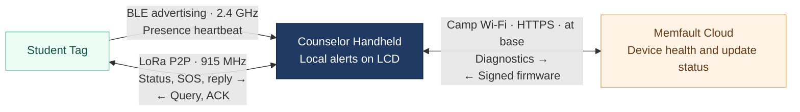

# BuddyGuard

**Team Number: 02**

**Team Name: Jet2Holiday**

| Team Member Name | Email Address                                                        |
| ---------------- | -------------------------------------------------------------------- |
| Siwei Lei        | [laialex@engineering.upenn.edu](mailto:laialex@engineering.upenn.edu)   |
| Rico Zhuang      | [zzhuan13@engineering.upenn.edu](mailto:zzhuan13@engineering.upenn.edu) |
| Yunzhe Deng      | [deng1@engineering.upenn.edu](mailto:deng1@engineering.upenn.edu)       |
| Yubin Guan       | [guan1@engineering.upenn.edu](mailto:guan1@engineering.upenn.edu)       |

**GitHub Repository URL:** [https://github.com/ese5180/f26-t02-wearable-buddy-system](https://github.com/ese5180/f26-t02-wearable-buddy-system)

## 3.8 Concept Refinement

### 3.8.1 Concept Review & Refresh

#### Description

The Greater Philadelphia YMCA's camp handbook prohibits camper cell phones and describes lost-camper drills and injury response. Camps already have a procedure for what to do when someone is missing or hurt. We're looking at the gap before staff notice that something happened. [Greater Philadelphia YMCA 2026 handbook, pp. 13, 18–19](https://www.philaymca.org/sites/default/files/2026-01/2026%20Camp%20Handbook%20Final.pdf)

#### Product Name & Function

BuddyGuard gives campers screen-free tags that check in over BLE and gives counselors a handheld that flags missed check-ins. The tag is designed to send LoRa SOS and possible-fall alerts, share an available GPS fix during an incident, and vibrate when the counselor sends a prompt. Field supervision runs on BLE and LoRa without Wi-Fi or cellular service, while Wi-Fi at base handles diagnostics and signed updates.

The October proposal made group monitoring the default, with buddy pairs as an optional mode for trips. We're validating group monitoring first. Both roles now use the same XIAO ESP32S3 / Wio-SX1262 kit. We tested BLE, LoRa, IMU movement and cloud updates with one tag and one counselor. GPS and vibration are in the MVP BOM and still need integration. Fall detection still needs validation.

#### Target Market & Demographics

Campers wear the tags. Counselors carry the receiver. The buyer is the camp operator, typically a camp director or recreation department. Our first market is Philadelphia day camps serving children ages 6–12 that take field trips or run outdoor activities.

The American Camp Association counts about **20,000 U.S. camps** across day and overnight programs. Philadelphia Parks & Recreation runs **more than 100 neighborhood day camps** and serves **more than 7,000 campers** across its summer camps. [ACA camp data](https://www.acacamps.org/sites/default/files/2025-07/ACA-Camp-Stabilization-Toolkit-2025.pdf) · [Philadelphia Parks &amp; Recreation](https://www.phila.gov/services/culture-recreation/activities-and-events/register-for-summer-camp/)

For a full group, we use **one counselor unit and eight tags** as a planning baseline, with six and ten tags as low and high cases. The YMCA publishes staff-to-camper ratios of 1:6, 1:8 and 1:10 by age. Those ratios inform the estimate. Actual group size and the number of groups a site would equip still need to be confirmed. For national context we assume **two equipped groups per camp**. For our Philadelphia shortlist, the base case is **one equipped group per site**. Each kit rents for one summer quarter per year. [Greater Philadelphia YMCA staffing ratios](https://www.philaymca.org/camps/summer-day-camp/)

We shortlisted five Philadelphia operators with **nine candidate sites**: the Schuylkill Center, Germantown Friends School, Penn Charter, ESF Camps at Friends Select, and five GPCA Summer Achievers K–8 sites. The Schuylkill Center and Penn Charter list field trips or day trips. None of these sites is a confirmed booking.

| Market | Sizing assumption | Equipment or rental estimate |
| --- | --- | --- |
| **TAM** · U.S. camps, upper bound | 20,000 camps × 2 groups | **40,000 counselor units + 320,000 tags** at eight tags per group |
| **SAM** · Philadelphia shortlist | 9 candidate sites × 1 eight-tag kit | **9 counselor units + 72 tags**, or **$5,841** per summer at $649 if every site rents |
| **SOM** · First summer paid pilot | 2 sites × 1 three-tag kit × $199 | **$398** in rental revenue before shipping |

At six or ten tags per group, the shortlist needs **54 or 90 tags**. Equipping two groups at every shortlisted site would mean **18 counselor units, 144 tags and $11,682 per summer**. The pilot uses the three-tag kit at **$199**, and the standard eight-tag rental is **$649** (see 3.8.5). The eight-tag kit still needs a capacity test. Next-season programming, group counts and who approves a rental are still unconfirmed for every site. [Quarterly Rental Model](https://docs.google.com/spreadsheets/d/1Vo3cIDeer3M5wfd5n27pI2ez8do8EjMCnAkfwn7qf3Q/edit?gid=385202602#gid=385202602)

#### Competitors and current practice

- **Headcounts and buddy checks** are part of existing camp supervision. YMCA of MEWSA uses headcounts during field trips, and YMCA of the North Shore trains staff to do headcounts and buddy checks. BuddyGuard adds an alert between checks, and the counselor follows the camp’s existing response procedure. [YMCA of MEWSA summer camp handbook](https://ymcaofmewsa.org/docs/default-source/summer-camp/ymca-of-mewsa-department-of-health-camp-parent-handbook-v2.pdf?sfvrsn=48b68f65_1) · [YMCA of the North Shore camp handbook](https://www.northshoreymca.org/wp-content/uploads/sites/28/2023/10/2023-YNS-Camp-Parent-Handbook.pdf)
- **Campminder / Campanion** helps staff record attendance and manage bus rosters. BuddyGuard can flag a missed check-in between headcounts, while the camp keeps its attendance system. [Campminder transportation](https://campminder.com/features/transportation/)
- **Garmin Bounce 2** gives families live location and two-way calling through an LTE service. Garmin announced it at $299.99 per watch and $9.99 per month for LTE. BuddyGuard gives camp staff one receiver for the group, with screen-free tags and local alerts that need no phone or cellular plan. [Garmin announcement](https://www.garmin.com/en-US/newsroom/press-release/sports-fitness/parents-can-delay-the-smartphone-with-bounce-2-kids-smartwatch-from-garmin/)
- **Nelos** already offers GPS tracking and group messaging over LoRa without cell service, using a phone paired with a radio. BuddyGuard uses a dedicated counselor unit for missing-tag alerts and plans to add possible-fall alerts. Staff can request a location if they need it. [Nelos](https://nelos.app/)

#### Stakeholders

We want to speak with a director and a lead counselor at a [Greater Philadelphia YMCA day camp](https://www.philaymca.org/camps/summer-day-camp/) or a [Philadelphia Parks &amp; Recreation site](https://www.phila.gov/services/culture-recreation/activities-and-events/register-for-summer-camp/). We also want to talk to a [Summer Achievers host-site operator](https://www.phila.gov/2026-05-08-register-now-make-this-summer-unforgettable-with-summer-achievers-summer-camp-at-edey-schools-2/) who organizes trips and summer activities. We will also contact the five operators on our Philadelphia shortlist. We want to find out how they handle a missing or injured camper, which trips have poor network coverage, and who approves a rental. A director and a counselor can also tell us what they need to see in an alert and how many children are in a group and how many groups they would equip. These interviews are still pending.

#### System-Level Diagrams

**Hardware**

Both units use the XIAO ESP32S3. The student tag carries the IMU, GNSS, SOS button, clasp sensor and vibration motor. The counselor handheld uses an LCD to show local alerts. A DRV2605L haptic driver shares the IMU's I²C bus and drives the vibration motor.

**Communication**

In the field, tags broadcast BLE check-ins and exchange LoRa packets directly with the assigned counselor handheld. The handheld flags missed check-ins on its LCD. Field supervision uses a star topology with the handheld at the center and runs without Wi-Fi or cellular service. At base, the handheld joins camp Wi-Fi, uploads device diagnostics over HTTPS, and pulls signed firmware from Memfault. The Memfault dashboard shows fleet health and update status.

#### Security Requirements Specification

**Overview.** Protect firmware updates and keep camper location within the assigned group.

**Definitions.** OTA means over-the-air update. A coredump is a snapshot of device memory taken after a crash.

**Functionality**

- **SEC 01.** MCUboot shall reject images that fail verification against the Team 2 ECDSA P-256 public key. Test with a valid image and a wrong-key image.
- **SEC 02.** The tag shall send GPS coordinates only to its assigned counselor unit over an authenticated and encrypted LoRa link, in response to a location request or SOS. Capture traffic during routine supervision and an incident.
- **SEC 03.** Cloud reports and coredumps shall exclude camper names, coordinates and private keys. Audit the report schema and crash capture regions before a pilot.
- **SEC 04.** Devices shall reject tampered or replayed incident messages. Modify and replay a captured packet to test this.
- **SEC 05.** Devices shall validate the HTTPS certificate and hostname before uploading diagnostics or downloading firmware. Test with an untrusted certificate.

Firmware signature checks have been tested. The GPS data path and radio security still need verification.

#### Hardware Requirements Specification

**Overview.** Both roles use the same ESP32S3/LoRa kit. The tag adds motion, location and vibration hardware.

**Definitions.** B2B means board-to-board. IMU means inertial measurement unit. GNSS is satellite positioning, including GPS.

**Functionality**

- **HRS 01.** Each unit shall use the XIAO ESP32S3 and Wio-SX1262 B2B kit with 2.4 GHz and 915 MHz antennas. Check assembly and read back the LoRa sync word over SPI.
- **HRS 02.** Each tag shall read a 6-axis IMU over 3.3 V I²C. We tested the SparkFun LSM6DSO. Verify the device ID and check the readings while moving the tag.
- **HRS 03.** Each tag shall read position fixes from a Seeed L76K GNSS module over UART. Verify a valid fix outdoors while LoRa remains operational.
- **HRS 04.** The screen-free wrist tag shall have a physical SOS button and a driver-controlled vibration motor. Check fit, send SOS and run the motor without resetting the tag.
- **HRS 05.** The counselor unit shall display the affected tag ID and alert type. Trigger a missing-tag alert and an SOS to check the display.

#### Software Requirements Specification

**Overview.** Zephyr runs the tag and counselor firmware. The counselor tracks presence and handles local incident alerts. The Wi-Fi worker handles cloud reporting and updates at base.

**Users.** Camp counselors use alerts and location requests. Fleet administrators manage devices and firmware.

**Definitions.** A heartbeat is a BLE presence message. A GPS fix is a position with a recorded time. A possible-fall alert is a prompt for staff to check on a camper.

**Functionality**

- **SRS 01.** With Wi-Fi and cellular service unavailable, the counselor shall monitor three tags and flag a previously seen tag within 11 seconds of its last fresh BLE message in the bench profile. Run a 30-minute group test, stop one tag and record time to alert and false alerts.
- **SRS 02.** The counselor shall query a missing tag over LoRa, stop after at most three attempts, and show reply or no reply. A fresh BLE message shall clear the missing state. Test reachable and unreachable tags.
- **SRS 03.** The tag shall send a possible-fall alert when the IMU classifier flags an event. Compare test-dummy falls with walking, running, jumping and removing the tag. Record misses and false alarms.
- **SRS 04.** The counselor shall be able to request a GPS fix and its age during an incident. A missing or stale fix shall be identified, and an SOS shall go out without waiting for a fix. Test with and without satellite reception.
- **SRS 05.** At base, devices shall report diagnostics and running firmware version to Memfault and stage signed updates for a trial boot. Verify a successful update and a rollback after watchdog reset before confirmation.

The bench demo has been verified with one tag and one counselor unit. The three-tag pilot test is still open. The commercial sizing baseline is eight tags per counselor unit, with six and ten as sensitivity cases. That capacity still needs testing. The fall classifier and GPS incident reporting still need testing. [Bench results](VALIDATION.md)

### 3.8.2 Power Budget

The BOM uses a 400 mAh LiPo. With 80% usable capacity, the tag has about 320 mAh. The first-pass estimates below use vendor currents as approximate battery-side loads, with Wi-Fi off.

| Tag mode                                                    | Approximate draw | Estimated runtime |
| ----------------------------------------------------------- | ---------------: | ----------------: |
| BLE active, LoRa receiving, IMU on, GPS in standby          |            90 mA |             3.6 h |
| Same conditions with GPS acquiring or tracking continuously |           131 mA |             2.4 h |

The L76K adds about 41 mA when active. The motor draws about 60 mA at 3 V while vibrating. Neither estimate includes LoRa transmit bursts or vibration duty cycle. Our target is 10 hours on a charge, which requires **32 mA or less** on this battery. Verify it with a battery discharge test and measure GPS standby, radio bursts and vibration on the assembled tag. The handheld's runtime is separate. Its LCD backlight and Wi-Fi draw at base still need measuring. [Power budget](https://docs.google.com/spreadsheets/d/1Vo3cIDeer3M5wfd5n27pI2ez8do8EjMCnAkfwn7qf3Q/edit?gid=385202602#gid=385202602) · [XIAO](https://wiki.seeedstudio.com/xiao_esp32s3_getting_started/) · [SX1262](https://www.semtech.com/products/wireless-rf/lora-connect/sx1262) · [LSM6DSO](https://www.st.com/en/mems-and-sensors/lsm6dso.html) · [L76K](https://wiki.seeedstudio.com/get_start_l76k_gnss/) · [Vibration motor](https://www.adafruit.com/product/1201)

### 3.8.3 Hardware BOM

The current BOM prices the three-tag pilot kit with one counselor unit. Each tag has GPS, the bench-tested SparkFun LSM6DSO IMU and a vibration motor on a DRV2605L haptic driver. The counselor unit adds a 1.14-inch SPI LCD. The workbook includes batteries, enclosures, straps, fasteners, charging and packaging. It totals **$258.12 for one kit** and **$221.26 per kit at volume**, using published 100+ price tiers where available and planning estimates elsewhere. Enclosures are priced as injection-molded ABS shells at about $0.35 per kit for material and processing. The prototype shells are 3D printed, and mold tooling is not included yet. [Hardware cost model](https://docs.google.com/spreadsheets/d/1Vo3cIDeer3M5wfd5n27pI2ez8do8EjMCnAkfwn7qf3Q/edit?gid=2071228825#gid=2071228825) · [MVP BOM](https://docs.google.com/spreadsheets/d/1GG7O95_0aSs89AQl4g6phD0VFDLTcqFAaMB5zflHOEA/edit?gid=2071228825#gid=2071228825) · [SparkFun pricing](https://www.sparkfun.com/sparkfun-6-degrees-of-freedom-breakout-lsm6dso-qwiic.html)

Each additional tag adds **$69.54** in materials (**$61.84** at volume). An **eight-tag kit with one counselor unit comes to $605.83** in materials (**$530.45** at volume). It carries forward the pilot kit’s charging and packaging estimates. Get quotes for a nine-device charging setup, packaging, enclosure tooling and assembly before treating this as a finished-kit cost.

### 3.8.4 Software BOM

The workbook budgets **$3,495/month** for Memfault Growth and **$10/month** for a proposed AWS backend. Growth lists 1,000 reporting devices. That covers 250 fully active four-device pilot kits or 111 nine-device kits. The prototype connects directly to Memfault, so we need to confirm whether an AWS backend is needed and get a quote for fleet size and OTA. [Software BOM](https://docs.google.com/spreadsheets/d/1Vo3cIDeer3M5wfd5n27pI2ez8do8EjMCnAkfwn7qf3Q/edit?gid=1647301774#gid=1647301774) · [Memfault pricing](https://memfault.com/pricing/)

### 3.8.5 Financial Model

We rent kits by the summer quarter.

| Offer | Kit | Rent per summer quarter |
| --- | --- | ---: |
| Paid pilot | 3 tags and 1 counselor handheld | $199 plus $15 shipping |
| Standard rental | 8 tags and 1 counselor handheld | $649, plus shipping at cost |
| Multi-kit reservation | 3 or more standard kits reserved in advance by one operator | $599 per kit, plus shipping at cost |

**Paid pilot.** Start with **one three-tag kit at each of two sites**, which brings in **$398** before shipping. After pilot materials and $25 turnaround per kit, the pilot loses about **$168** before cloud costs. Its job is to measure time to notice a staged separation, false alerts, actual turnaround cost and paid renewals. The workbook keeps the earlier 3,000-kit sell-vs-rent comparison as a legacy tab. The quarterly rental model replaces it. [Quarterly Rental Model](https://docs.google.com/spreadsheets/d/1Vo3cIDeer3M5wfd5n27pI2ez8do8EjMCnAkfwn7qf3Q/edit?gid=385202602#gid=385202602)

#### Standard rental

The commercial model assumes a **$650** finished-kit cost, **$50** in turnaround costs and a **$40** allowance for loss, repairs and support per paid rental, and **$40** in annual cloud costs per owned kit. Each kit has one summer rental opportunity per year and an assumed three-year life. The $650 figure is a cost target. Eight-tag materials alone are $605.83 at single-unit prices, so $650 leaves about $44 for assembly, or about $120 at volume pricing.

| Summer utilization | Payback at $649 | Three-year direct result per kit |
| --- | ---: | ---: |
| 50% | 2.71 years | +$68.50 |
| 75% | 1.71 years | +$487.75 |
| 90% | 1.40 years | +$739.30 |

The three-year result is paid rentals × ($649 − $50 − $40) − $650 − (3 × $40). Break-even is **45.9%** of summer quarters rented. At 75% utilization, the $599 multi-kit rate pays back in 1.90 years. At 50%, it needs 3.03 years, which is longer than the assumed kit life. Payback is a fleet-average estimate and excludes company R&D, sales and overhead. Outbound shipping is billed separately at cost.

Cloud is the largest unverified cost. If all nine devices report, the listed Memfault Growth plan covers 111 full kits and costs roughly **$378 per kit per year** at full allocation on a twelve-month subscription. At 75% utilization, that plan would produce a three-year loss of about **$526** per kit. Break-even would need 106% utilization, which one summer slot per year cannot reach. Cloud has to stay under about **$203 per kit per year** to break even at 75%. The commercial prices and cloud costs still need validation. Confirm seasonal pricing, OTA coverage and whether all tags need to report. We plan to confirm paid reservations and small-fleet cloud costs before building commercial inventory. [Memfault pricing](https://memfault.com/pricing/)
