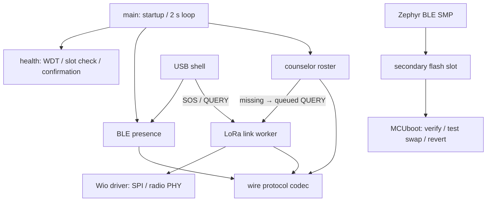

# BuddyGuard firmware explanation

[Optional SparkFun LSM6DSO / IMU guide](IMU_LSM6DSO.md)

[中文](../zh/FIRMWARE.md) · [Reproduction guide](GETTING_STARTED.md)

This describes the modular **1.1.18** source. The on-air protocol remains version 1 and compatible with the previously validated 1.1.15 bench firmware. Build/flash/update commands belong in the reproduction guide; this document explains ownership, data flow and constraints.

## Module map

| Source / public interface | Responsibility |
|---|---|
| `src/main.c` | Startup order and the two-second service loop |
| `src/ble/presence.c` / `include/presence.h` | BLE stack, advertising data, connection lifecycle, heartbeat and maintenance admission |
| `src/roster/roster.c` / `include/roster.h` | Counselor passive scanner and per-tag presence/loss/recovery state; no-op on tags |
| `src/radio/link.c` / `include/radio_link.h` | LoRa event queue, worker, sequences, retries/ACK, role-specific QUERY/REPLY |
| `src/drivers/wio_sx1262.c` / `include/radio_driver.h` | Deferred device initialization, PHY settings, SPI readback and serialized RX/TX |
| `src/sensors/imu.c` / `include/imu.h` | Optional LSM6DSO worker, address detection, six-axis snapshot and freshness |
| `src/protocol/motion.c` / `include/motion.h` | Pure C UNKNOWN/STILL/MOVING classifier |
| `src/protocol/wire.c` / `include/wire.h` | Hardware-independent encoding and frame validation; shared by firmware and native tests |
| `src/platform/health.c` / `include/health.h` | Watchdog, flash-slot readiness and delayed MCUboot confirmation |
| `src/console/commands.c` | USB shell adapter calling service APIs |

`firmware/CMakeLists.txt` lists application modules explicitly. `prj.conf` enables Zephyr services; `Kconfig` defines product/demo parameters; `app.overlay` defines the Wio B2B hardware. `sysbuild.conf` and `sysbuild/mcuboot.conf` configure the signed boot chain. `conf/` holds reference role/fault overlays; `scripts/build.py` generates an explicit per-build profile, so its role/ID/fault options are authoritative for documented builds.

## Execution and ownership

1. Main logs version, role and confirmation state, then arms the **8-second reset watchdog before radio initialization**. Wio uses deferred initialization so an unresponsive BUSY pin cannot hang before the application has watchdog protection.
2. It checks both image slots, initializes Wio (readback must be `0x1424`), enables BLE and starts the counselor scanner when applicable. Failure deliberately waits without watchdog feeds.
3. On an unconfirmed fault-test build, it deliberately stops here without feeding WDT. Otherwise it starts the optional IMU worker and healthy-runtime timer.
4. Every two seconds it polls the roster, increments the BLE presence sequence and updates advertising. Advertising errors reset the healthy window and withhold the watchdog feed. On successful cycles, it may confirm the image after **15 seconds**, then feeds WDT.

A healthy cycle means these startup checks and BLE loop are working. It does **not** prove successful LoRa delivery, correct sensor data or supervision safety. Image confirmation also requires the demo heartbeat enabled. Disabling heartbeat does not itself reset the healthy timer; this preserves the prior implementation. The watchdog only monitors the main loop, not independent progress of every worker.

The LoRa worker has its own 3072-byte stack, priority 5 and an eight-entry request queue. It starts only after the radio passes initialization. **Only that worker calls runtime radio send/receive**, preventing simultaneous LoRa transactions from shell/main. Shell SOS/QUERY only enqueue requests and may return an error if full. BLE callbacks use atomics for connection/restart state; the scanner publishes last-seen/sequence/maintenance atomics consumed by main. The roster fields are individual atomic values, not a transactional snapshot. Presence sequence increments even during a connected SMP session, but those advertisements are paused.

When BLE disconnects, advertising restarts after the connection object is recycled. Stopping a connectable advertisement also recycles an internally reserved connection, so the callback must distinguish an actual disconnection; unconditionally restarting would cause an advertising loop.

## Roles and roster state

Tag IDs are 1–3; counselor ID is 200. Tags advertise and send LoRa STATUS. C01 advertises for management, passively scans tag presence, ACKs events and requests missing-tag status. This is **counselor-to-tag supervision**, not implemented child-to-child pairing.

A previously unseen tag is ignored until a valid first frame. C01 emits ONLINE on first observation. Only a **changed sequence number** refreshes last-seen time; duplicate advertisements do not extend presence. In normal mode, age greater than 8000 ms emits BLE MISSING once and queues a LoRa QUERY. Two-second polling adds detection latency (approximately 8–10 seconds on the bench). A fresh BLE frame emits RECOVERED. LoRa REPLY is logged separately and cannot clear missing-BLE status.

From 1.1.18, the scanner explicitly disables controller duplicate filtering (`BT_LE_SCAN_OPT_NONE`). The convenience `BT_LE_SCAN_PASSIVE` macro enabled that filtering, and changing heartbeat payloads were not delivered reliably during the 1.1.17 bench run. The application already filters by sequence; it needs reports for fresh payloads from the same address. Scan interval/window and the 8-second timeout are unchanged. See the dated IMU validation for the before/after observations.

If the latest tag frame has its maintenance flag set, the roster uses 600 seconds instead. The maintenance window admits BLE SMP connections for 300 seconds by default (`bg maintenance 0..600` overrides it). A connected transfer can finish after the admission deadline. The flag and bounded grace reduce expected-update false alarms but do not guarantee an alarm-free update. Normal frames restore the short timeout.

## On-air formats

All multibyte payload numbers below use little endian. No child names or coordinates are included. LoRa carries an optional motion classification; raw six-axis readings stay in local logs.

### BLE manufacturer data (8 bytes)

| Offset | Size | Meaning |
|---|---|---|
| 0 | 2 | `FF FF`, laboratory company placeholder |
| 2 | 1 | Protocol = 1 |
| 3 | 1 | Device ID |
| 4 | 2 | Presence sequence, wraps at 65535 |
| 6 | 1 | Flags: bit 0 maintenance; bit 1 image unconfirmed |
| 7 | 1 | Role: 1 tag; 2 counselor |

The legacy advertising payload totals 31 bytes: flags, SMP service UUID and manufacturer field. Maintenance scan response includes the device name. Outside maintenance, advertising is non-connectable; names are not supplied in scan response. `wire.c` roster decoding requires exact size/company/protocol, role tag, ID1–3 and no undefined flags. `tools/bg_ble.py` decodes the six manufacturer bytes **after** the company ID, as supplied by Bleak, and historically accepts other nonzero tag IDs; the deployed roster intentionally limits the demo to three tags.

### LoRa application frame (12 bytes)

| Offset | Size | Meaning |
|---|---|---|
| 0 | 2 | ASCII `BG` |
| 2 | 1 | Protocol = 1 |
| 3 | 1 | STATUS=1, ACK=2, SOS=3, QUERY=4, REPLY=5 |
| 4 | 1 | Target/source tag ID1–3 |
| 5 | 1 | Flags, currently 0 |
| 6 | 2 | Radio sequence, independent of BLE sequence |
| 8 | 1 | Motion: 0 UNKNOWN, 1 STILL, 2 MOVING |
| 9 | 1 | Clasp, 0 = UNKNOWN |
| 10 | 2 | Battery, `FFFF` = unavailable |

Validation checks exact size/magic/protocol, known type and ID range; it does not authenticate senders, prevent replay or validate every sensor/flag value. STATUS starts about three seconds after worker startup, then ten seconds after the preceding send completes. STATUS/SOS/REPLY get up to three attempts with a 600 ms ACK wait and deterministic 100–220 ms backoff. Matching requires ACK type, same tag and same radio sequence. TX errors return without further retries.

C01 remembers only the last `(sequence,type)` per tag to suppress consecutive duplicate event logs, but ACKs duplicates again. A tag replies to a QUERY addressed to its own ID, reusing the query sequence. QUERY itself is sent once without ACK/retry tracking. Frames other than the awaited ACK are consumed during ACK waits and are not deferred; collisions can therefore lose queries/events. This is a documented follow-up task, not solved by modularization.

## Hardware and radio settings

| Signal | ESP32S3 GPIO |
|---|---|
| SPI SCK / MISO / MOSI | 7 / 8 / 9 (board pinctrl) |
| NSS / RESET | 41 / 42 |
| BUSY / DIO1 | 40 / 39 |
| Antenna enable | 38 |

In Devicetree, GPIO32–53 use `gpio1` offsets 0–21; e.g. GPIO41 is `gpio1 9`. Keep upstream GPIO register definitions unchanged. SPI max is 2 MHz. Wio uses DIO2 TX switching, DIO3 TCXO at 3.0 V with 10 ms startup, and explicit **DC-DC** regulator mode. These settings target the ESP32S3 B2B kit, not a different XIAO/radio module variant.

PHY: 915 MHz, SF7, BW125 kHz, CR4/5, preamble8, private network, normal IQ, TX4 dBm. Both ends must match. Driver initialization reads registers `0x0740..0x0741` for private sync word `0x1424`; `0xffff` previously indicated the incorrectly seated B2B connection. A correct readback checks SPI communication, not antenna/range performance. Send always attempts to return the radio to RX mode. See [the module datasheet](https://files.seeedstudio.com/products/SenseCAP/Wio_SX1262/Wio-SX1262_Module_Datasheet.pdf) and [hardware review](../REVIEW-2026-10-30.md).

## Signed updates and storage

`sysbuild` builds MCUboot plus the application. MCUboot uses ECDSA-P256, primary validation and **swap using move**. The build script supplies a private key from outside Git; only the public verification key is embedded. The host sends the signed application through BLE SMP into secondary flash, marks it for **test**, and resets. MCUboot verifies it, swaps the test image into primary, and preserves a return path. The application confirms itself only after its health window. An unconfirmed failed image resets through WDT and MCUboot reverts to the prior confirmed image. The host never confirms an image.

| Region | Offset | Allocated size |
|---|---|---|
| MCUboot | `0x000000` | `0x10000` |
| System reservation | `0x010000` | `0x10000` |
| Primary slot | `0x020000` | `0x150000` = 1,376,256 bytes |
| Secondary slot | `0x170000` | `0x150000` = 1,376,256 bytes |

Physical flash is 8 MiB. Additional upstream reservations follow the listed regions; generated `zephyr.dts` is authoritative. Slots include image header/trailer/swap overhead; usable payload is smaller than allocation. Do not change the partition map as part of routine OTA. `buddyguard-build.json` records actual signed file size/hash; file size is neither partition capacity nor RAM usage. Inspect generated build outputs for final bootloader size.

Signature checking provides application-image authenticity relative to this lab bootloader. **ESP hardware secure-boot eFuses and flash encryption are not enabled**. The development USB loader remains available. BLE SMP access is unpaired/unauthenticated at transport level; a signed image does not authorize the person opening management commands. Wrong-role images signed by the team key are also trusted. No anti-rollback version policy has been configured. Do not describe this as a locked-down production device.

## Shell and host tools

| Command | Meaning |
|---|---|
| `bg status` | Version, role, ID, BLE sequence, connection, maintenance and confirmation |
| `bg maintenance 0..600` | Set management connection admission deadline |
| `bg heartbeat on/off` | Enable/stop BLE presence only; LoRa remains active |
| `bg sos` | Tag: enqueue SOS |
| `bg query 1..3` | Counselor: enqueue one status query |
| `bg reboot` | Cold reset |

`tools/bg_serial.py` operates USB shell/logging. `tools/bg_ble.py` handles discovery, SMP images/upload/test/reset and the combined update flow, capped at 244-byte packets by default. `scripts/backup_flash.py` creates external full-flash backups; `flash_initial.py` performs destructive initial provisioning; `build.py` pins workspace/role/signing inputs and verifies the output. Native tests compile `wire.c` with the host compiler; Python tests also check the host BLE decoder. Build reports and hardware evidence complement tests; they do not replace RF testing.

## Implemented scope and limits

Implemented: optional SparkFun LSM6DSO sensing with `--imu` (see linked IMU guide); two-board BLE presence/roster; LoRa STATUS/SOS/ACK/QUERY/REPLY; serial demo controls; signed BLE test updates, interruption/resume, rejection and watchdog revert. Consult [the dated validation record](../../evidence/validation.md) for exactly which version/test was observed.

Pending: actual buddy pairing; full three-tag concurrent operation; clasp, vibration, battery and GNSS integration; Wi-Fi/cloud; field range and collision testing; robust query retry and receive deferral; authenticated/replay-resistant business frames; authorized management; rotating session IDs. IDs are currently static. Absence of GPS does not make radio identifiers private. Sensors must report real values or UNKNOWN; do not insert simulated data into a real alert.

To extend the firmware, keep sensor hardware in a dedicated driver/service and expose a snapshot to the protocol producer; version the protocol when its meaning changes. Do not place SPI access in shell callbacks, block BLE callbacks, or make a second thread operate the LoRa device. Add security/pairing/range requirements before presenting the prototype as child-safety equipment.

## Optional MCUboot UART recovery

`--serial-recovery` adds a separate bootloader-level SMP server on UART0 (D6 TX/GPIO43, D7 RX/GPIO44). The pinned MCUboot Kconfig needs the automatically applied threading prerequisite; the resulting bootloader is63,728 bytes and retains the existing partitions/team public root. The host probes frequently during reset entry, then allows longer image-hash replies. It writes primary directly, so it does not use BLE test activation or preserve that primary during an interrupted transfer. See the [complete UART procedure](UART_RECOVERY.md) and dated evidence.
