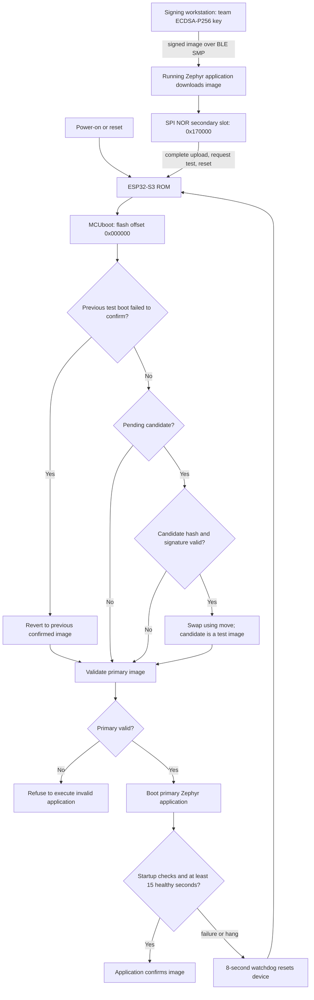
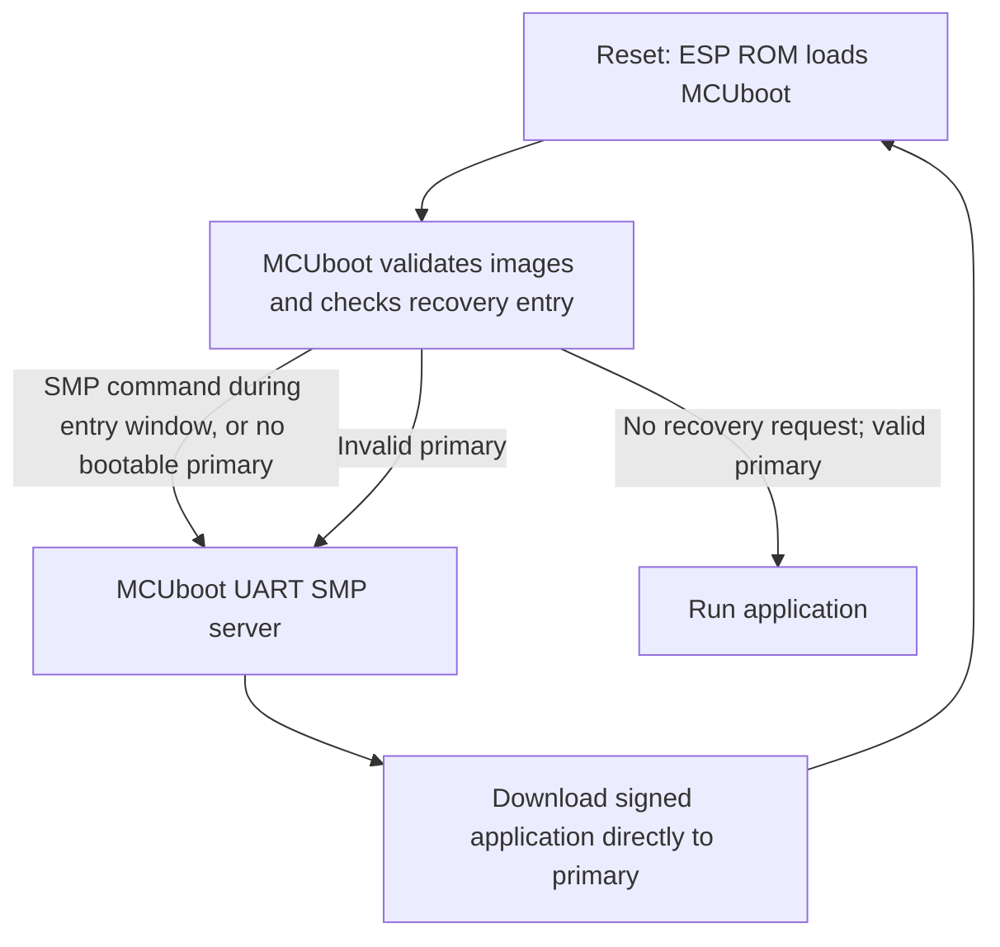

# Firmware Security Implementation — BuddyGuard Team 2

[中文](../zh/FIRMWARE_SECURITY_CHECKOFF.md) · [Repository](https://github.com/ese5180/f26-t02-wearable-buddy-system/tree/codex/buddyguard-wireless-fota) · [PR #1](https://github.com/ese5180/f26-t02-wearable-buddy-system/pull/1)

Status on **2026-10-31**: normal signed BLE FOTA is implemented and hardware-tested. T01 was last verified at1.1.17 (LSM6DSO enabled); C01 now runs1.1.19. **MCUboot UART recovery is installed and hardware-tested on C01**, including valid signed upload, wrong-key rejection and restoration without a working application. The course's interpretation of external storage is identified below.

## 3.5.1 Bootloading process

The running application receives the signed candidate into the secondary slot while the confirmed primary remains available. After the host requests a test upgrade and reset, the ESP32-S3 ROM loads MCUboot. MCUboot validates the candidate and performs a move-based swap. The candidate starts unconfirmed. The application checks image-slot availability, LoRa initialization/readback and BLE startup, then runs its advertising loop. After at least 15 healthy seconds with heartbeat enabled it confirms itself. A startup failure or advertising-loop failure withholds watchdog feeds; a deliberately failing test image resets and MCUboot reverts to the prior confirmed image. A failed prior test boot is handled before the normal pending-update path.

This local health gate does not prove every business function or future runtime behavior. In particular, an absent optional IMU reports UNKNOWN without blocking confirmation. Faults appearing after an image has already confirmed do not automatically receive the same trial-image revert protection.

## Bootloader and application sizes

These are **binary file sizes**, not RAM usage or allocated partition sizes. Measurements come from the exact installed builds in [current-builds.json](../../evidence/current-builds.json).

| Component | Version | Unsigned application / bootloader bytes | Signed application bytes |
|---|---|---:|---:|
| MCUboot on T01 | Existing BLE configuration | 46,672 (45.58 KiB) | Not an application image |
| MCUboot on C01 | UART recovery enabled | 63,728 (62.23 KiB) | Not an application image |
| T01 tag with LSM6DSO | 1.1.17 | 436,660 (426.43 KiB) | 436,812 (426.57 KiB) |
| C01 counselor | 1.1.19 | 435,412 (425.21 KiB) | 435,564 (425.36 KiB) |

The bootloader partition is 65,536 bytes (64 KiB). Each application slot is 1,376,256 bytes (1,344 KiB), including header/trailer/swap overhead. The signed file is the application artifact sent over BLE; initial USB provisioning also installs the separate MCUboot binary.

## Who downloads the image?

**The Zephyr application downloads normal FOTA images.** Its MCUmgr image-management server receives BLE SMP requests and writes the secondary Flash slot. MCUboot handles boot-time validation, activation, test/revert and transfer of control. It does not implement the current BLE download path.

The implemented extra-credit path differs: MCUboot itself runs an SMP server over UART, allowing recovery before the application starts or when no valid application exists.

## Wireless transport and rationale

We use **BLE SMP/MCUmgr** for image-state queries, signed-image upload and test/reset requests. BLE was already enabled for BuddyGuard presence, and the Mac can update a nearby device without an access point, network credentials or cloud service. Zephyr provides the corresponding image-management service.

The hardware also has Wi-Fi and LoRa. Wi-Fi could provide higher throughput but would require another network/update path that is not integrated in this milestone. Our LoRa protocol transports small 12-byte supervision messages; transmitting an approximately 436 KB image would require a bulk-transfer/fragmentation protocol and substantially more airtime. BLE therefore provides a practical local maintenance path while LoRa remains dedicated to supervision messages. The current client defaults to 244-byte SMP packets; transfers take several minutes on the bench.

## Where downloaded images are stored

Both slots are on the XIAO's **on-board 8 MiB external SPI NOR Flash**, not in RAM:

| Region | Flash offset | Allocation |
|---|---|---|
| MCUboot | `0x000000` | `0x10000` |
| System reservation | `0x010000` | `0x10000` |
| Primary application | `0x020000` | `0x150000` |
| Downloaded candidate / secondary | `0x170000` | `0x150000` |

The current board map uses the lower 4 MiB for these and additional upstream reservations. Physical Flash capacity is 8 MiB; the complete generated Devicetree is authoritative. [Seeed's schematic](https://files.seeedstudio.com/wiki/SeeedStudio-XIAO-ESP32S3/new-res/202003751_XIAO%20ESP32S3_v1.4_SCH_260226.pdf.pdf) shows a separate SPI NOR device (U5 GD25Q64ENIGR) and ESP32-S3R8 (U1).

We have not added a second independent Flash module. If the course means Flash external to the MCU, this is the relevant hardware. If it specifically requires an additional storage chip/module separate from the boot Flash, that requirement still needs confirmation with Nick; do not describe a second module as present.

## Enabled failure-handling mechanisms and evidence

| Failure | Mechanism | Observed evidence |
|---|---|---|
| Wrong signing key | MCUboot validates ECDSA-P256 using the team public root | Candidate1.3.0 completed BLE upload but was rejected at boot; prior confirmed1.1.0 remained active |
| Corrupted signed download | Image hash/signature validation before activation | Corrupted1.4.0 completed upload; prior confirmed1.1.1 remained active after reset |
| Correct signature, faulty trial code | Test boot, delayed self-confirmation, 8-second watchdog and move-swap revert | Signed1.2.1 booted, stopped feeding WDT and reverted to confirmed1.1.16 |
| Interrupted download | Secondary-slot staging; no test request until completion; SHA-based client resume | Transfer stopped at87,258 bytes (20%); old primary stayed confirmed; same-file upload resumed at that offset |
| Reset during a swap | MCUboot's move-swap status/progress handling | Enabled by the configured algorithm; deliberate power-cut-during-swap was not hardware-tested |

See [dated validation](../../evidence/validation.md) and [v1.1.16 watchdog regression](../../evidence/modularization-20261030.md). The BLE negative cases were tested on the recorded earlier versions; UART wrong-key rejection was additionally tested on C01 as recorded below. Valid BLE upgrades and confirmation were recorded for T01 1.1.17 and C01 1.1.18; C01 1.1.19 was subsequently installed and tested through UART as documented below. Upload success or an SMP `bootable` field alone is not proof that a signature was accepted: reset and verify the actual active version and confirmation state.

## Configuration and signing identity

Key files in the repository:

- [prj.conf](../../firmware/prj.conf): `CONFIG_BOOTLOADER_MCUBOOT=y`, image management, BLE SMP and Flash management.
- [sysbuild.conf](../../firmware/sysbuild.conf): MCUboot, ECDSA-P256 and `SB_CONFIG_MCUBOOT_MODE_SWAP_USING_MOVE=y`.
- [mcuboot.conf](../../firmware/sysbuild/mcuboot.conf): `CONFIG_BOOT_VALIDATE_SLOT0=y`, `CONFIG_BOOT_UPGRADE_ONLY=n`.
- [health.c](../../firmware/src/platform/health.c): watchdog and delayed application confirmation.
- [build.py](../../scripts/build.py): external private-key selection and post-build verification.
- [team public root](../../keys/team2-signing-public.pem): public verification material only.

The signing identity is uniquely generated for Team2, rather than MCUboot's distributed example key. Private material stays outside Git. ESP hardware Secure Boot eFuses and Flash encryption are not enabled, so this is application-signature enforcement by MCUboot, not a physically locked boot chain. Management authorization, anti-downgrade policy and authenticated supervision messages are separate pending work.

## Extra-credit UART serial recovery: hardware result

**Implemented and demonstrated on C01.** The complete [UART recovery runbook](UART_RECOVERY.md), [dated validation](../../evidence/uart-recovery-20261031.md) and [machine-readable results](../../evidence/uart-recovery-20261031-summary.json) describe the commands and observed evidence.

| Check | Observed result |
|---|---|
| Full backup and isolated bootloader update |8 MiB backed up; bootloader readback matched; all bytes at/above 0x10000 unchanged |
| Bootloader size |63,728 bytes, leaving 1,808 bytes in the original 64 KiB allocation |
| True UART transport |CP2102→UART0,115200 8N1, D6 TX/GPIO43 and D7 RX/GPIO44; XIAO powered separately by USB |
| Valid team-signed application |1.1.19 uploaded through MCUboot UART, then actually booted as COUNSELOR; confirmed1 |
| Wrong-key application |1.3.1 validates under its own test key, fails team-root verification; UART upload completed but primary was excluded by MCUboot validation and did not execute after reset |
| No-application recovery |MCUboot still responded about 33 seconds after bad-image reset, beyond the normal entry window; only the valid secondary was listed |
| Final restoration |Good 1.1.19 uploaded again over UART with no working application/BLE required; boot, BLE active/confirmed and LoRa SPI 0x1424 verified |

The final configuration is in [mcuboot-serial.conf](../../firmware/conf/mcuboot-serial.conf), [UART overlay](../../firmware/conf/mcuboot-serial.overlay), the guarded [bootloader installer](../../scripts/install_recovery_bootloader.py) and [UART host tool](../../tools/bg_uart_recovery.py). The pinned ESP32 Xtensa single-thread configuration received bytes but did not service the interrupt-driven adapter; a narrow [MCUboot Kconfig prerequisite](../../patches/mcuboot-esp32-uart-threading.patch), applied automatically by `build.py --serial-recovery`, enables multithreading. Merely setting the hidden symbol in a config fragment did not enable it. Ordinary BLE/LoRa builds retain their threading default. A second fresh build verified the final scripted recovery configuration.

The default [MCUboot UART target is primary](https://docs.mcuboot.com/serial_recovery.html). This recovery mode can overwrite the old application and does not provide BLE secondary staging/test-swap protection. The valid recovery boot in this run was already confirmed; do not count it as a new delayed-confirmation or faulty-image rollback test. `BOOT_VALIDATE_SLOT0` enforces signatures; `BOOT_SERIAL_NO_APPLICATION` keeps recovery available after invalid application installation. ESP ROM USB flashing and the application shell are not this feature.

Only C01 plus the TTL adapter were connected during this test; two-device LoRa/IMU behavior was not re-tested. Earlier tag/sensor/radio evidence remains separately dated. Physical UART authorization, secure-boot eFuses, Flash encryption and anti-downgrade remain outside the implemented scope. The cable's logic voltage was not independently measured; use a documented3.3V UART adapter for reproduction.
