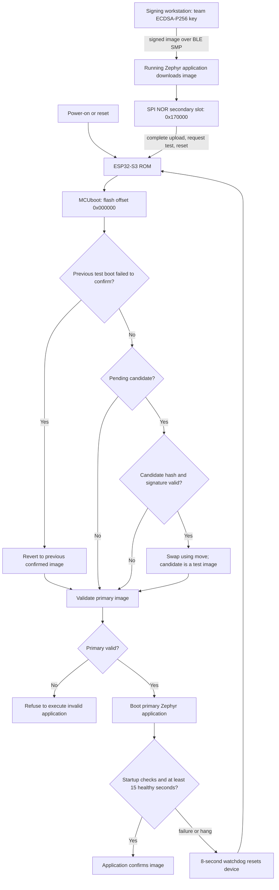

# Firmware Security Implementation — BuddyGuard Team 2

[中文](../zh/FIRMWARE_SECURITY_CHECKOFF.md) · [Repository](https://github.com/ese5180/f26-t02-wearable-buddy-system/tree/codex/buddyguard-wireless-fota) · [PR #1](https://github.com/ese5180/f26-t02-wearable-buddy-system/pull/1)

Status on **2026-10-31**: normal signed BLE FOTA is implemented and hardware-tested. The installed devices are T01 1.1.17 (LSM6DSO enabled) and C01 1.1.18. UART recovery is a **compile-tested feasibility configuration only**, not installed or demonstrated. The course's interpretation of external storage is identified below.

## 3.5.1 Bootloading process



The running application receives the signed candidate into the secondary slot while the confirmed primary remains available. After the host requests a test upgrade and reset, the ESP32-S3 ROM loads MCUboot. MCUboot validates the candidate and performs a move-based swap. The candidate starts unconfirmed. The application checks image-slot availability, LoRa initialization/readback and BLE startup, then runs its advertising loop. After at least 15 healthy seconds with heartbeat enabled it confirms itself. A startup failure or advertising-loop failure withholds watchdog feeds; a deliberately failing test image resets and MCUboot reverts to the prior confirmed image. A failed prior test boot is handled before the normal pending-update path.

This local health gate does not prove every business function or future runtime behavior. In particular, an absent optional IMU reports UNKNOWN without blocking confirmation. Faults appearing after an image has already confirmed do not automatically receive the same trial-image revert protection.

## Bootloader and application sizes

These are **binary file sizes**, not RAM usage or allocated partition sizes. Measurements come from the exact installed builds in [current-builds.json](../../evidence/current-builds.json).

| Component | Version | Unsigned application / bootloader bytes | Signed application bytes |
|---|---|---:|---:|
| MCUboot | Existing deployed configuration | 46,672 (45.58 KiB) | Not an application image |
| T01 tag with LSM6DSO | 1.1.17 | 436,660 (426.43 KiB) | 436,812 (426.57 KiB) |
| C01 counselor | 1.1.18 | 435,428 (425.22 KiB) | 435,578 (425.37 KiB) |

The bootloader partition is 65,536 bytes (64 KiB). Each application slot is 1,376,256 bytes (1,344 KiB), including header/trailer/swap overhead. The signed file is the application artifact sent over BLE; initial USB provisioning also installs the separate MCUboot binary.

## Who downloads the image?

**The Zephyr application downloads normal FOTA images.** Its MCUmgr image-management server receives BLE SMP requests and writes the secondary Flash slot. MCUboot handles boot-time validation, activation, test/revert and transfer of control. It does not implement the current BLE download path.

The proposed extra-credit path differs: MCUboot itself would run an SMP server over UART, allowing recovery before the application starts.

## Wireless transport and rationale

We use **BLE SMP/MCUmgr** for image-state queries, signed-image upload and test/reset requests. BLE was already enabled for BuddyGuard presence, and the Mac can update a nearby device without an access point, network credentials or cloud service. Zephyr provides the corresponding image-management service.

The hardware also has Wi-Fi and LoRa. Wi-Fi could provide higher throughput but would require another network/update path that is not integrated in this milestone. Our LoRa protocol transports small 12-byte supervision messages; transmitting an approximately 436 KB image would require a bulk-transfer/fragmentation protocol and substantially more airtime. BLE therefore provides a practical local maintenance path while LoRa remains dedicated to supervision messages. The current client defaults to 244-byte SMP packets; transfers take several minutes on the bench.

## Where downloaded images are stored

Both slots are on the XIAO's **on-board 8 MiB external SPI NOR Flash**, not in RAM:

| Region | Flash offset | Allocation |
|---|---|---|
| MCUboot | `0x000000` | `0x10000` |
| System reservation | `0x010000` | `0x10000` |
| Primary application | `0x020000` | `0x150000` |
| Downloaded candidate / secondary | `0x170000` | `0x150000` |

The current board map uses the lower 4 MiB for these and additional upstream reservations. Physical Flash capacity is 8 MiB; the complete generated Devicetree is authoritative. [Seeed's schematic](https://files.seeedstudio.com/wiki/SeeedStudio-XIAO-ESP32S3/new-res/202003751_XIAO%20ESP32S3_v1.4_SCH_260226.pdf.pdf) shows a separate SPI NOR device (U5 GD25Q64ENIGR) and ESP32-S3R8 (U1).

We have not added a second independent Flash module. If the course means Flash external to the MCU, this is the relevant hardware. If it specifically requires an additional storage chip/module separate from the boot Flash, that requirement still needs confirmation with Nick; do not describe a second module as present.

## Enabled failure-handling mechanisms and evidence

| Failure | Mechanism | Observed evidence |
|---|---|---|
| Wrong signing key | MCUboot validates ECDSA-P256 using the team public root | Candidate1.3.0 completed BLE upload but was rejected at boot; prior confirmed1.1.0 remained active |
| Corrupted signed download | Image hash/signature validation before activation | Corrupted1.4.0 completed upload; prior confirmed1.1.1 remained active after reset |
| Correct signature, faulty trial code | Test boot, delayed self-confirmation, 8-second watchdog and move-swap revert | Signed1.2.1 booted, stopped feeding WDT and reverted to confirmed1.1.16 |
| Interrupted download | Secondary-slot staging; no test request until completion; SHA-based client resume | Transfer stopped at87,258 bytes (20%); old primary stayed confirmed; same-file upload resumed at that offset |
| Reset during a swap | MCUboot's move-swap status/progress handling | Enabled by the configured algorithm; deliberate power-cut-during-swap was not hardware-tested |

See [dated validation](../../evidence/validation.md) and [v1.1.16 watchdog regression](../../evidence/modularization-20261030.md). Negative cases were tested on the recorded earlier versions; they were not repeated after the optional IMU addition. Recent valid BLE upgrades and confirmation are recorded for the currently installed versions. Upload success or an SMP `bootable` field alone is not proof that a signature was accepted: reset and verify the actual active version and confirmation state.

## Configuration and signing identity

Key files in the repository:

- [prj.conf](../../firmware/prj.conf): `CONFIG_BOOTLOADER_MCUBOOT=y`, image management, BLE SMP and Flash management.
- [sysbuild.conf](../../firmware/sysbuild.conf): MCUboot, ECDSA-P256 and `SB_CONFIG_MCUBOOT_MODE_SWAP_USING_MOVE=y`.
- [mcuboot.conf](../../firmware/sysbuild/mcuboot.conf): `CONFIG_BOOT_VALIDATE_SLOT0=y`, `CONFIG_BOOT_UPGRADE_ONLY=n`.
- [health.c](../../firmware/src/platform/health.c): watchdog and delayed application confirmation.
- [build.py](../../scripts/build.py): external private-key selection and post-build verification.
- [team public root](../../keys/team2-signing-public.pem): public verification material only.

The signing identity is uniquely generated for Team2, rather than MCUboot's distributed example key. Private material stays outside Git. ESP hardware Secure Boot eFuses and Flash encryption are not enabled, so this is application-signature enforcement by MCUboot, not a physically locked boot chain. Management authorization, anti-downgrade policy and authenticated supervision messages are separate pending work.

## Extra-credit UART serial recovery: assessment

**Recommendation: feasible and worth attempting; not yet completed.** The team has a USB-to-TTL adapter. A throwaway copy of the project was built with UART recovery enabled, retaining the same signature settings, partitions and primary validation. It was not flashed to either device.

| Feasibility check | Result |
|---|---|
| Required adapter | Team reports a USB-to-TTL module; verify its TX/RX logic really is3.3V |
| True UART pins | UART0 TX=D6/GPIO43, RX=D7/GPIO44; not used by current LoRa or IMU mappings |
| Compiled recovery bootloader | **60,624 bytes (59.20 KiB)** |
| Existing bootloader partition | 65,536 bytes; **4,912 bytes remain** |
| Existing host library | `SMPSerialTransport` is available in the host environment |
| Hardware UART upload and bad-signature test | **Not performed** |
| Current deployed `CONFIG_MCUBOOT_SERIAL` | **Disabled** |

Proposed MCUboot-only additions, used for the feasibility build:

```conf
CONFIG_SERIAL=y
CONFIG_MCUBOOT_SERIAL=y
CONFIG_BOOT_SERIAL_UART=y
CONFIG_BOOT_SERIAL_ENTRANCE_GPIO=n
CONFIG_BOOT_SERIAL_WAIT_FOR_DFU=y
CONFIG_BOOT_SERIAL_WAIT_FOR_DFU_TIMEOUT=3000
CONFIG_BOOT_SERIAL_NO_APPLICATION=y
# Retain CONFIG_BOOT_VALIDATE_SLOT0=y and the existing ECDSA-P256 root.
```

The MCUboot overlay routes management to UART0 while keeping USB logging separate:

```dts
/ {
    chosen {
        zephyr,uart-mcumgr = &uart0;
    };
};
```

Proposed wiring, with XIAO powered by USB: adapter TX→XIAO D7/RX, adapter RX←XIAO D6/TX, GND↔GND. Leave adapter VCC and DTR/RTS disconnected initially. Do not hold BOOT/GPIO0 during reset to enter MCUboot: that selects the ESP ROM loader. The three-second MCUboot wait window avoids requiring another entrance button.

Implementation/checkoff sequence:

1. Back up one board's current full Flash and preserve its known-good artifacts/key.
2. Install the new MCUboot image through physical USB while preserving application slots and the partition map. Normal application BLE OTA cannot replace the bootloader; do not use the erase-all first-provisioning script for this step.
3. Reset, enter the MCUboot UART wait window with a matching serial SMP client, and query/list images before the application starts.
4. Upload a correctly signed application through UART, reset, and verify its active version and application confirmation. Demonstrate recovery independently of a working BLE application.
5. Show that a corrupted or wrongly signed candidate is not executed; then restore the valid signed application and recheck BLE/LoRa/IMU.

[MCUboot serial-recovery documentation](https://docs.mcuboot.com/serial_recovery.html) describes SMP recovery and its default upload target: **the primary slot**. This proposed minimal recovery path may overwrite the existing primary; it does not inherit BLE staging's guarantee of retaining that primary during download. `BOOT_SERIAL_NO_APPLICATION` keeps recovery available when there is no bootable application, and primary validation must stay enabled. Upload acceptance alone is not a signature test; check the actual boot result. A secondary-slot UART workflow is possible but needs explicit slot selection and activation design beyond this feasibility build.

Existing esptool/ESP ROM USB provisioning and the application `bg` shell are not this extra-credit feature. Extra credit should be claimed only after the MCUboot-level UART signed-image recovery and rejection tests pass on hardware.
