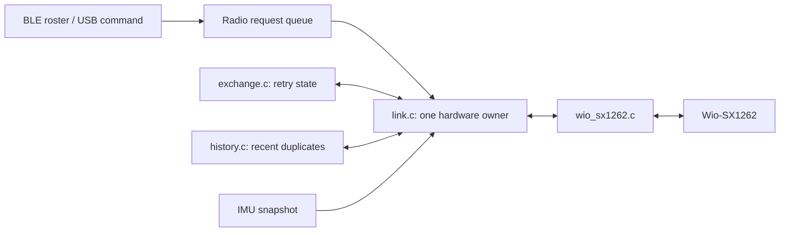

# Wireless reliability and reproduction — 1.1.20

[中文](../zh/WIRELESS_RELIABILITY.md) · [Firmware explanation](FIRMWARE.md) · [Environment setup](GETTING_STARTED.md)

This iteration covers BLE FOTA regression and LoRa receive/retry handling. The external CP2102/TTL recovery cable is not required. Native USB supplies power/development commands; firmware data travels over BLE. Installed bootloaders remain unchanged.

## Learn the modules in this order

| Module | Owns | Delegates |
|---|---|---|
| `src/main.c` | Startup order and application health loop | Protocol details |
| `src/drivers/wio_sx1262.c` | Hardware initialization, 915 MHz settings, one send/receive operation | Retry and business policy |
| `src/protocol/wire.c` | Eight-byte BLE and twelve-byte LoRa encoding/validation | Scheduling |
| `src/radio/exchange.c` | One transaction's deadlines, retries and response matching | Zephyr, SPI, logging and sleeping |
| `src/radio/history.c` | Last sixteen business-message identities | Authentication or replay security |
| `src/radio/link.c` | Sole radio thread, request queue, every RX dispatch, logs and ACKs | BLE or sensor bus access |
| `src/roster/roster.c` | Counselor BLE roster and missing-tag query request | Waiting for LoRa replies |
| `src/sensors/imu.c` | Independent sampling and real motion snapshots | Radio access |
| `src/platform/health.c` | Watchdog and normal BLE trial-image health confirmation | Complete business validation |

Read the public headers in `firmware/include/`, then `tests/radio_vectors.c`, then the implementations. The policy tests compile the actual C source with the host compiler; they do not emulate an RF channel.



## Transaction behavior

- STATUS, SOS and REPLY expect ACK, with a 600 ms deadline.
- QUERY expects REPLY from the same tag with the same sequence, with a 1500 ms deadline.
- Each transaction permits at most three sends. Retries retain the sequence and use short deterministic tag/sequence backoff.
- Waiting/backoff is represented as state. There is no nested ACK receive loop: every valid packet reaches the dispatcher. The existing 200 ms synchronous receive window is retained so a very short timeout does not cut packets off. Timeout decisions may be delayed by one receive window.
- A counselor waiting for a query reply still reports and ACKs an incoming STATUS/SOS. A tag waiting for a STATUS ACK can defer a received query response until that transaction finishes.
- Duplicate queries coalesce with an active/deferred reply. The tag keeps one deferred query response; replacing it with a different query sequence produces a warning.
- Recent duplicate business frames are ACKed again but reported only once. The sixteen-entry cache is bounded duplicate suppression, not replay protection. A reboot that reuses a recent sequence can be mistaken for a duplicate until eviction; a future session-aware protocol is needed to distinguish it reliably.

The on-air frame remains protocol1 and twelve bytes. ACK byte5, previously reserved, can now identify the acknowledged message type. New peers check nonzero type values and accept legacy zero ACKs during rolling upgrades. Legacy ACKs provide weaker type disambiguation. Identifiers, frame authentication and anti-downgrade policy are unchanged in this iteration.

`bg radio` exposes counters since boot: send attempts, completed/exhausted transactions, valid RX, other packets dispatched while a transaction waits, duplicate business frames, queries/replies and request-queue drops. Fields are read atomically but the aggregate is an approximate snapshot. Reboot resets them.

## Build and update

Follow the main setup guide and retain the original team signing identity. Run from the repository root; replace paths and ports for your machine:

```sh
BG_WS="$HOME/buddyguard-workspace"
BG_KEY="$HOME/.config/buddyguard/team2-signing/firmware-ecdsa-p256.pem"
C01=/dev/cu.usbmodem101
T01=/dev/cu.usbmodem1101
.venv/bin/python -m serial.tools.list_ports -v
.venv/bin/python -m unittest discover -s tests -v
"$BG_WS/.venv/bin/python" scripts/build.py --workspace "$BG_WS" --key "$BG_KEY" \
  --build-dir "$BG_WS/build-radio20-c01" --role counselor --serial-recovery --version 1.1.20
"$BG_WS/.venv/bin/python" scripts/build.py --workspace "$BG_WS" --key "$BG_KEY" \
  --build-dir "$BG_WS/build-radio20-t01" --role tag --tag-id 1 --imu --version 1.1.20
```

Identify roles with `bg status`, never port numbering alone. Counselor `--serial-recovery` reproduces its build profile; BLE transfers only the signed application and does not reinstall MCUboot. Do not use the initial erase-all provisioning flow here.

```sh
.venv/bin/python tools/bg_serial.py --port "$C01" command bg maintenance 600
.venv/bin/python tools/bg_ble.py --name BG-C01 update "$BG_WS/build-radio20-c01/firmware/zephyr/zephyr.signed.bin"
.venv/bin/python tools/bg_serial.py --port "$C01" command bg status
.venv/bin/python tools/bg_ble.py --name BG-C01 images
.venv/bin/python tools/bg_serial.py --port "$T01" command bg maintenance 600
.venv/bin/python tools/bg_ble.py --name BG-T01 update "$BG_WS/build-radio20-t01/firmware/zephyr/zephyr.signed.bin"
```

Allow normal startup and at least the fifteen-second health interval; verify the actual version/role, `confirmed=1`, and SMP active/confirmed state. Start a USB monitor in a separate terminal before updating if startup/confirmation evidence is needed:

```sh
.venv/bin/python tools/bg_serial.py --port "$C01" --log evidence/raw/my-c01.log monitor --seconds 600
```

Only one process should read each serial port. With a monitor already running, append `command --no-read` when sending commands. It writes without clearing the input buffer or consuming the monitor's output:

```sh
.venv/bin/python tools/bg_serial.py --port "$C01" command --no-read bg query 1
```

Without a separate monitor, use ordinary `command bg ...` to read the reply. Likewise, run only one BLE client against a device; wait for complete teardown before reconnecting after interruption.

## Wireless test sequence

1. Check both `bg status` outputs and tag `bg imu`: real fresh samples and correct roles/versions.
2. Close maintenance on both with `bg maintenance 0`; observe fresh sequences at the counselor.
3. Counselor `bg query 1`: require QUERY transmission, same-sequence REPLY, QUERY complete and an ACK received by the tag.
4. Tag `bg sos`: require one counselor ACTION and completion of the tag ACK transaction.
5. Counselor `bg query 2` while only T01 exists: require at most three sends and an exhausted/unconfirmed result; T01 STATUS/SOS must still be processed during that query wait.
6. Tag `bg heartbeat off` must produce BLE MISSING and an automatic query. `bg heartbeat on` must produce RECOVERED. This stops BLE advertisements, not LoRa or device power.
7. Read both `bg radio` counters and correlate retry/exhaustion/interleaving with logs. Missing acknowledgement is a communication outcome, not proof that a child is lost.

A thirty-minute continuous bench run is a suggested acceptance duration, not a measured coverage range or child-safety qualification. Record actual results separately; a test plan is not proof of a test pass.

## FOTA regression

BLE trial activation and UART direct-primary recovery are different paths. After installing a recovery MCUboot, repeat BLE valid upload/self-confirmation, wrong-key/corruption rejection and a correctly signed faulty trial image that watchdog-resets and reverts.

Negative images must retain the counselor role. Send their applications to secondary through BLE; never install their generated bootloaders. Keep the valid1.1.20 image available. Signing root, partition map, watchdog and acceptance criteria are in the [security explanation](FIRMWARE_SECURITY_CHECKOFF.md). Do not manually confirm images with `confirm=True` to conceal a failed health gate.

### Repeatable BLE negative tests

Start from an active/confirmed correct C01 1.1.20 and capture USB logs in another terminal. Between tests, wait for complete BLE client teardown and verify the correct primary before proceeding.

Create a separate test key outside Git, once, without overwriting the team key:

```sh
BG_BAD_KEY="$HOME/.config/buddyguard/team2-signing/wrong-key-test.pem"
if [ ! -f "$BG_BAD_KEY" ]; then
  "$BG_WS/.venv/bin/imgtool" keygen -k "$BG_BAD_KEY" -t ecdsa-p256
fi
chmod 600 "$BG_BAD_KEY"
"$BG_WS/.venv/bin/python" scripts/build.py --workspace "$BG_WS" --key "$BG_BAD_KEY" \
  --build-dir "$BG_WS/build-radio20-wrong" --role counselor --version 1.3.2
"$BG_WS/.venv/bin/python" scripts/build.py --workspace "$BG_WS" --key "$BG_KEY" \
  --build-dir "$BG_WS/build-radio20-corrupt-source" --role counselor --version 1.4.1
"$BG_WS/.venv/bin/python" scripts/build.py --workspace "$BG_WS" --key "$BG_KEY" \
  --build-dir "$BG_WS/build-radio20-fault" --role counselor --fault --version 1.2.2
```

**Do not install any of these generated bootloaders.** Transfer only their signed applications through BLE.

Wrong-root test: offline verification against the team public key must fail; then send the candidate to secondary for boot-time rejection:

```sh
"$BG_WS/.venv/bin/imgtool" verify -k keys/team2-signing-public.pem "$BG_WS/build-radio20-wrong/firmware/zephyr/zephyr.signed.bin"
.venv/bin/python tools/bg_serial.py --port "$C01" command --no-read bg maintenance 600
.venv/bin/python tools/bg_ble.py --name BG-C01 update "$BG_WS/build-radio20-wrong/firmware/zephyr/zephyr.signed.bin"
# Wait for the correct1.1.20 USB startup, then query:
.venv/bin/python tools/bg_ble.py --name BG-C01 images
```

Corruption test: copy the separate1.4.1 image, alter only the copy's signed data, and preserve its source:

```sh
.venv/bin/python - "$BG_WS/build-radio20-corrupt-source/firmware/zephyr/zephyr.signed.bin" "$BG_WS/corrupt-1.4.1.signed.bin" <<'PY'
from pathlib import Path
import sys
source, target = map(Path, sys.argv[1:])
assert not target.exists(), 'Preserve prior artifacts; choose a new target.'
data = bytearray(source.read_bytes())
data[0x400] ^= 1
target.write_bytes(data)
PY
"$BG_WS/.venv/bin/imgtool" verify -k keys/team2-signing-public.pem "$BG_WS/corrupt-1.4.1.signed.bin"
.venv/bin/python tools/bg_serial.py --port "$C01" command --no-read bg maintenance 600
.venv/bin/python tools/bg_ble.py --name BG-C01 update "$BG_WS/corrupt-1.4.1.signed.bin"
# Wait for correct1.1.20 startup, then query images.
```

Offline verification failure is expected in both cases. Upload completion is not signature acceptance: require active1.1.20, confirmed=true and the original good-image digest after reset.

Validly signed fault image, with interruption/resume:

```sh
.venv/bin/python tools/bg_serial.py --port "$C01" command --no-read bg maintenance 600
.venv/bin/python tools/bg_ble.py --name BG-C01 upload "$BG_WS/build-radio20-fault/firmware/zephyr/zephyr.signed.bin" --stop-at 20
.venv/bin/python tools/bg_ble.py --name BG-C01 images
.venv/bin/python tools/bg_ble.py --name BG-C01 update "$BG_WS/build-radio20-fault/firmware/zephyr/zephyr.signed.bin"
```

Use exactly the same file so resumption starts at a nonzero offset. At the deliberate20% pause, the old primary must remain active/confirmed. After completion/test activation,1.2.2 must actually start unconfirmed, print the fault banner, stop feeding WDT, reset and revert to1.1.20. Require all three observations: fault-image startup, watchdog reset and restoration. Finish with heartbeat enabled, maintenance closed and both roles/versions verified.

After the tests, clean C01's inactive secondary instead of leaving the fault candidate:

```sh
.venv/bin/python tools/bg_ble.py --name BG-C01 erase-secondary
```

The helper requires exactly one active confirmed primary and no pending activation. It erases only slot1; no primary-slot parameter is exposed. Bulk erase may lose its BLE acknowledgement. The helper reconnects for readback without repeating the erase, requires the original primary version/digest and no listed secondary candidate, then reports success. This checks MCUmgr image state, not every Flash byte or secure erasure. A failed readback remains an error.

## Repeat this five-minute normal-operation check

Connect only T01 and C01, verify role/version/confirmation and run one USB monitor per board. This script schedules20 T01 queries at15-second intervals,8 SOS requests and one query to absent T02. It sends real device commands; it does not generate sensor data or declare a pass. Count completion events and compare retry/exhaustion/counter deltas in the captured logs.

```sh
.venv/bin/python - "$C01" "$T01" <<'PYTHON'
import subprocess, sys, time
counselor, tag = sys.argv[1:]
def send(port, *words):
    subprocess.run([sys.executable, 'tools/bg_serial.py', '--port', port,
                    'command', '--no-read', *words], check=True,
                   stdout=subprocess.DEVNULL)
for port in (counselor, tag):
    send(port, 'bg', 'heartbeat', 'on')
    send(port, 'bg', 'maintenance', '0')
time.sleep(4)
for port in (counselor, tag):
    send(port, 'bg', 'radio')
start = time.monotonic()
for i in range(20):
    time.sleep(max(0, start + i * 15 - time.monotonic()))
    if i == 1:
        send(counselor, 'bg', 'query', '2')
    send(counselor, 'bg', 'query', '1')
    if i % 3 == 0 or i == 1:
        send(tag, 'bg', 'sos')
time.sleep(max(0, start + 300 - time.monotonic()))
for port in (counselor, tag):
    send(port, 'bg', 'radio')
    send(port, 'bg', 'status')
send(tag, 'bg', 'imu')
PYTHON
```

This run observed20/20 query completions and8/8 SOS receptions without unexpected reset/missing/queue drops. Retries occurred. Five minutes does not replace full30-minute, outdoor-range or three-tag validation.
