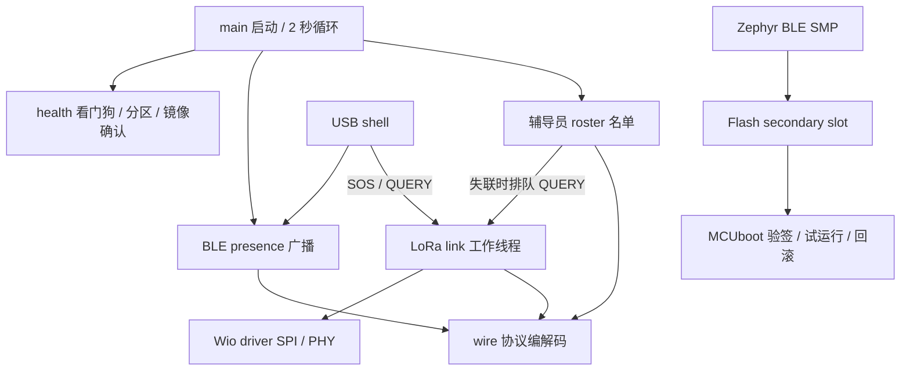

# BuddyGuard：固件解释文档

[可选 SparkFun LSM6DSO 接入文档](IMU_LSM6DSO.md)

[English](../en/FIRMWARE.md) · [队友复现操作文档](GETTING_STARTED.md)

本文对应模块化后的 **1.1.20** 源码。无线协议仍为版本 1，与此前验证的 1.1.15 兼容。具体安装／烧录命令见操作文档；这里解释模块职责、运行机制及限制。

## 模块划分

| 源文件／公开接口 | 职责 |
|---|---|
| `src/main.c` | 启动顺序和每两秒一次的服务循环 |
| `src/ble/presence.c` / `include/presence.h` | BLE 初始化、广播、连接生命周期、心跳开关和维护接入窗口 |
| `src/roster/roster.c` / `include/roster.h` | 辅导员被动扫描、标签名单、失联及恢复；标签端为空实现 |
| `src/radio/link.c` / `include/radio_link.h` | LoRa 消息队列、工作线程、序列号、ACK／重试、QUERY／REPLY |
| `src/radio/exchange.c` / `include/radio_exchange.h` | 无硬件依赖的事务期限、重试和完成匹配 |
| `src/radio/history.c` / `include/radio_history.h` | 最近业务消息的有限去重记录 |
| `src/drivers/wio_sx1262.c` / `include/radio_driver.h` | 延迟设备初始化、射频参数、SPI 读回、串行收发 |
| `src/sensors/imu.c` / `include/imu.h` | 可选 LSM6DSO 后台线程、地址识别、六轴快照及过期检查 |
| `src/protocol/motion.c` / `include/motion.h` | 纯 C UNKNOWN／STILL／MOVING 状态判断 |
| `src/protocol/wire.c` / `include/wire.h` | 不依赖 RTOS／硬件的编码和帧校验，可直接进行本机 C 测试 |
| `src/platform/health.c` / `include/health.h` | watchdog、Flash 分区就绪检查、延迟确认新镜像 |
| `src/console/commands.c` | USB shell 到各服务 API 的命令适配 |

`CMakeLists.txt` 显式列出模块；`prj.conf` 开启 Zephyr 服务，`Kconfig` 定义实验参数，`app.overlay` 描述 Wio B2B 连接，`sysbuild.conf` 与 `sysbuild/mcuboot.conf` 配置签名引导。`conf/` 保留角色／故障参考配置；按操作文档构建时，`scripts/build.py` 生成的独立 profile 决定角色、ID 和故障开关。

## 启动与线程职责

1. 主线程先输出版本、角色、确认状态，**在初始化 radio 之前启动 8 秒复位 watchdog**。Wio 使用 deferred initialization，避免 BUSY 卡住时还没进入应用就失去 watchdog 回滚保护。
2. 检查两个镜像分区、初始化 Wio 并核对同步字 `0x1424`、启动 BLE、按角色启动名单扫描。失败后故意不喂狗，等待复位。
3. 如果是尚未确认的故障测试镜像，停在这里不喂狗；否则启动可选 IMU 后台线程和健康运行计时。
4. 每两秒轮询名单、递增 BLE 序号、更新广播。广播错误则重置健康计时且不喂狗；成功循环中达到 **15 秒**后可以确认镜像，然后喂狗。

“健康”仅表示这些启动检查与 BLE 主循环正常，**不保证 LoRa 成功送达、传感器有效或儿童安全**。确认还要求 heartbeat 为 on。关闭 heartbeat 本身不会重置计时，保留原有实现。watchdog 监测主循环，并不逐个监测所有工作线程是否前进。

LoRa 工作线程栈 3072 字节、优先级 5，请求队列容量 8，radio 初始化通过后才开始。**运行期间只有这个线程操作 LoRa 收发**，shell／主线程只排队，队列满可以失败，避免多个调用者竞争射频。BLE 回调通过 atomic 传递连接／重启状态；扫描回调写入 last-seen、sequence、maintenance，主循环读取。这些是独立原子值，并非事务一致的快照。SMP 连接期间 BLE 序号仍递增，但 presence 广播暂停。

连接断开后，必须等连接对象 recycled 再重启广播。停止可连接广播也会回收预留连接对象，因此不能在每次 recycled 时无条件重启，否则会产生反复启停。

## 角色与名单状态

标签 ID 为 1–3，辅导员 ID 为 200。标签广播 presence 并发送 LoRa STATUS；C01 为管理入口广播，同时被动扫描标签、ACK 事件及询问失联标签。当前实现是**辅导员监测标签**，尚未实现儿童标签之间配对。

从未看到的标签暂不报警；首次有效帧产生 ONLINE。只有**改变的序号**更新 last-seen，重复广播不算新的心跳。正常状态超过 8000 ms 没有新帧，产生一次 BLE MISSING 并排队 LoRa QUERY。主循环两秒轮询，因此实际大约 8–10 秒检测到。恢复新 BLE 帧后输出 RECOVERED。LoRa REPLY 单独记录，不能清除 BLE 失联。

1.1.18 起显式关闭扫描器的控制器去重（`BT_LE_SCAN_OPT_NONE`）。此前使用的 `BT_LE_SCAN_PASSIVE` 宏默认开启去重，1.1.17 实测中不断变化的心跳没有稳定送到应用层。应用本身按序号去重，需要接收同一地址的新数据；扫描窗口／间隔和 8 秒阈值保持不变。前后实测见日期对应的 IMU 验证记录。

最后一帧带 maintenance 标志时改用 600 秒宽限。维护接入窗口默认 300 秒，可通过 `bg maintenance 0..600` 改变；窗口截止后不再接新连接，已经连接的上传可继续。宽限减少正常 OTA 期间误报，但不是无限屏蔽，卡住或过长仍会失联。收到新的正常广播后恢复短超时。

## 无线帧格式

下列多字节字段均为小端。不发送孩子姓名或坐标。LoRa 可携带运动分类，原始六轴读数只在本机日志查看。

### BLE manufacturer data：8 字节

| 偏移 | 长度 | 含义 |
|---|---|---|
| 0 | 2 | `FF FF`，实验 company ID 占位值 |
| 2 | 1 | 协议版本 1 |
| 3 | 1 | 设备 ID |
| 4 | 2 | presence 序号，65535 后回绕 |
| 6 | 1 | bit0 维护状态；bit1 镜像尚未确认 |
| 7 | 1 | 角色：1 标签、2 辅导员 |

传统广播共 31 字节，包括 flags、SMP 服务 UUID、manufacturer 字段。维护模式的 scan response 带设备名；非维护模式不可连接，scan response 不带名字。

`wire.c` 名单解析要求长度、company ID、协议、标签角色、ID1–3、flags 都有效。`tools/bg_ble.py` 接收 Bleak 去掉 company ID 后的 **6 字节**，历史上允许其他非零标签 ID；板端名单有意限制为实验的三个标签。

### LoRa 应用帧：12 字节

| 偏移 | 长度 | 含义 |
|---|---|---|
| 0 | 2 | ASCII `BG` |
| 2 | 1 | 协议版本 1 |
| 3 | 1 | STATUS=1、ACK=2、SOS=3、QUERY=4、REPLY=5 |
| 4 | 1 | 来源／目标标签 ID1–3 |
| 5 | 1 | ACK 可填写原消息类型；兼容旧0值。其他消息为0 |
| 6 | 2 | LoRa 序号，与 BLE 序号独立 |
| 8 | 1 | motion：0 UNKNOWN、1 STILL、2 MOVING |
| 9 | 1 | clasp，0=UNKNOWN |
| 10 | 2 | 电池，`FFFF`=unavailable |

校验只检查长度、magic、协议、类型和 ID，不认证发送方或防重放。首个 STATUS 约在工作线程启动3秒后到期，之后距前一个 STATUS 开始约10秒，排队事务可能延迟它。STATUS／SOS／REPLY 等 ACK600 ms，QUERY 等同标签同序号的 REPLY1500 ms；均最多发送3次，重试保留序号，并用标签／序号决定短退避。发送驱动错误也消耗一次尝试，保证有限重试。

`exchange.c` 只维护一个事务，不休眠、不调用硬件；`link.c` 在等待／退避时仍使用原200 ms接收窗口分发每个有效帧，超时决策可能延迟一个窗口。辅导员等待查询时仍处理并确认 STATUS／SOS。标签可暂存一个查询回复，现有事务完成后发出；相同查询的重传会合并。`history.c` 保存最近16个 `(tag,type,sequence)`，重复业务消息仍 ACK，但不重复记录事件。该有限历史不是安全防重放；新 ACK 的非零byte5可区分原消息类型，旧0值 ACK 为滚动升级保留较弱兼容匹配。

完整流程、测试和 `bg radio` 计数见[无线可靠性与复现](WIRELESS_RELIABILITY.md)。LoRa 仍是半双工，发送时不能同时接收，重试后也可能失败。未确认只表示通信未确认，不能直接推断儿童状态。

## 硬件与射频配置

| 信号 | ESP32S3 GPIO |
|---|---|
| SPI SCK / MISO / MOSI | 7 / 8 / 9，来自板级 pinctrl |
| NSS / RESET | 41 / 42 |
| BUSY / DIO1 | 40 / 39 |
| 天线使能 | 38 |

Devicetree 的 GPIO32–53 对应 `gpio1` 偏移 0–21，例如 GPIO41 是 `gpio1 9`。**不要改上游 GPIO 寄存器基址定义。**SPI 上限 2 MHz；DIO2 控制 TX 切换，DIO3 以 3.0 V 供 TCXO，启动等待 10 ms；显式使用 **DC-DC** 稳压模式。这些配置仅针对 ESP32S3 B2B 套装。

射频参数：915 MHz、SF7、BW125 kHz、CR4/5、preamble8、私有网络、正常 IQ、TX4 dBm，两端必须一致。初始化读取 `0x0740..0x0741`，期望私有同步字 `0x1424`。此前 `0xffff` 与 B2B 未扣紧有关。读回正常证明 SPI 能通信，不证明天线／通信距离正常。每次发送后都会尝试切回 RX。

依据：[模块 datasheet](https://files.seeedstudio.com/products/SenseCAP/Wio_SX1262/Wio-SX1262_Module_Datasheet.pdf)、[本次硬件复核记录](../REVIEW-2026-10-30.md)。

## 签名更新与存储

sysbuild 同时构建 MCUboot 和应用。MCUboot 使用 ECDSA-P256、primary 验证、**swap using move**。构建脚本从 Git 外读取私钥，设备只嵌入公钥。电脑通过 BLE SMP 把签名应用写到 secondary，标记 **test** 后复位；MCUboot 验证并交换试运行镜像，保留回退路径。应用健康运行后自己确认；未确认的故障镜像被 watchdog 复位后，MCUboot 恢复此前 confirmed 镜像。电脑不会代为永久确认。

| 区域 | 起始地址 | 分配容量 |
|---|---|---|
| MCUboot | `0x000000` | `0x10000` |
| 系统保留 | `0x010000` | `0x10000` |
| Primary slot | `0x020000` | `0x150000` = 1,376,256 字节 |
| Secondary slot | `0x170000` | `0x150000` = 1,376,256 字节 |

物理 Flash 为 8 MiB，表后还有上游保留区，完整布局以构建生成的 `zephyr.dts` 为准。分区包含 header、trailer 和 swap 开销，实际有效载荷小于分配容量；普通 OTA 不应改变分区。`buddyguard-build.json` 记录签名文件大小／哈希，文件大小不等于分区容量或 RAM 占用；最终 bootloader 大小看生成产物。

这里的签名保证相对于实验 MCUboot 的应用真实性。**未开启 ESP 硬件 secure-boot eFuse／Flash 加密**，开发 USB loader 仍可用。BLE SMP 未配对，传输层没有操作者授权；镜像签名不等于管理命令访问授权。共用签名根接受误选的另一角色镜像；未设置反降级版本策略。不能称为生产级锁定设备。

## 命令与工具

| 命令 | 作用 |
|---|---|
| `bg radio` | 事务完成／耗尽、交错收包、重复帧和队列计数 |
| `bg status` | 版本、角色、ID、BLE 序号、连接、维护、确认状态 |
| `bg maintenance 0..600` | 设定管理接入截止时间 |
| `bg heartbeat on/off` | 开关 BLE presence，LoRa 不停 |
| `bg sos` | 标签端：排队 SOS |
| `bg query 1..3` | 辅导员：排队一次查询 |
| `bg reboot` | 冷复位 |

`tools/bg_serial.py` 负责 USB 命令／日志（独立 monitor 已运行时，用 `command --no-read` 发命令）；`tools/bg_ble.py` 负责 BLE 发现、SMP images/upload/test/reset/update及受保护的secondary清理，默认 244 字节包。`scripts/backup_flash.py` 建立外部整片备份，`flash_initial.py` 擦除后首次安装，`build.py` 固定工作区／角色／签名参数并验证产物。

本机测试用 C 编译器直接编译 wire、motion、exchange、history 的实际策略源码，另有 Python BLE 解码测试。测试、构建报告和实板证据互补，不能替代射频现场测试。

## 已实现范围与限制

已实现：可选 SparkFun LSM6DSO 采样与运动状态（使用 `--imu`，见接入文档）；双板 BLE presence／名单、LoRa STATUS／SOS／ACK／QUERY／REPLY、串口演示、BLE 签名试运行更新、中断续传、拒绝错误镜像、watchdog 回滚。具体在哪个版本上做过哪些实测，以[有日期的验证记录](../../evidence/validation.md)为准。

待做：儿童之间配对；三标签完整并发；搭扣、振动、电量、GNSS；Wi-Fi／云；户外范围／碰撞测试；业务帧认证／防重放；管理授权；轮换 session ID。**当前 ID 是静态的**，没有 GPS 不意味着无线标识私密。传感器必须输出真实测量或 UNKNOWN，不能在真实报警里插入伪造值。

扩展时把传感器硬件放在独立驱动／服务，由协议发送方读取状态快照；含义改变时升级协议版本。不要在 shell 直接访问 SPI、阻塞 BLE 回调或让第二个线程同时操作 LoRa。成为儿童安全设备之前还需定义并验证安全、配对及距离／覆盖要求。

## 可选 MCUboot UART 恢复

`--serial-recovery` 在 bootloader 内增加 UART0 SMP 服务（D6 TX/GPIO43，D7 RX/GPIO44）。固定 MCUboot 版本需要由构建脚本自动应用的线程默认值修复；最终 bootloader 为63,728字节，保留原分区与团队公钥。电脑工具在复位时快速探测，再给槽位哈希查询较长超时。此路径直接写 primary，不走 BLE test 激活，上传中断也不能保证原 primary 应用保留。详见[完整操作流程](UART_RECOVERY.md)与日期对应证据。
