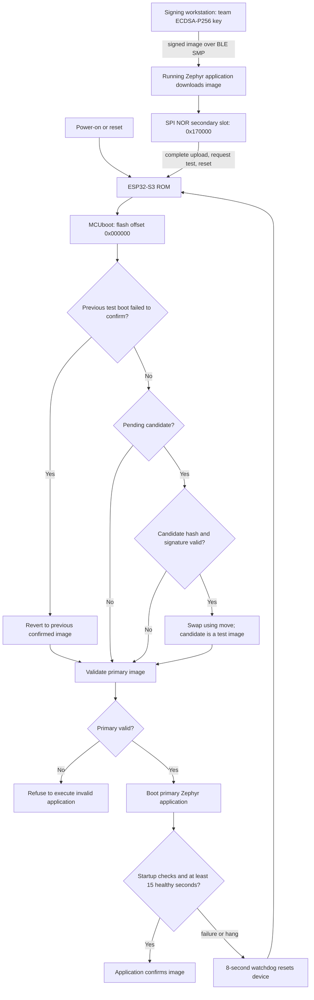

# Firmware Security Implementation — Team 2 回答与评估

[English 提交版](../en/FIRMWARE_SECURITY_CHECKOFF.md) · [GitHub 代码分支](https://github.com/ese5180/f26-t02-wearable-buddy-system/tree/codex/buddyguard-wireless-fota) · [PR #1](https://github.com/ese5180/f26-t02-wearable-buddy-system/pull/1)

截至 **2026-10-31**：正常 BLE 签名 FOTA 已实现并实测；当前标签1.1.17（含 IMU），辅导员1.1.18。UART recovery 目前只是**临时工程编译验证，未烧录、未串口实测**。外部 Flash 的课程口径见下文。

## 3.5.1 启动与更新流程



电脑使用 Team2 独有 ECDSA-P256 私钥签名，通过 BLE SMP 将镜像交给正在运行的 Zephyr 应用。应用把它写入 secondary，完成后请求 test upgrade 并复位。ESP32-S3 ROM 启动 MCUboot；MCUboot 校验候选镜像哈希与签名，通过后按 swap using move 切换，作为未确认镜像试运行。应用启动 watchdog，检查分区、LoRa 初始化及 SPI 读回、BLE 启动与广播循环。至少15秒健康运行且 heartbeat 开启后自确认；启动失败或广播循环异常不喂狗，8秒 watchdog 复位，未确认试运行镜像由 MCUboot 回滚到此前 confirmed 版本。

健康检查不是所有业务功能的证明：可选 IMU 缺失只报告 UNKNOWN，不阻止镜像确认；已经 confirmed 后才出现的错误，不保证自动按试运行路径回滚。

## Bootloader 与应用大小

下表是**实际二进制文件大小**，不是 RAM 或预留分区大小。数据来自已安装镜像的 [current-builds.json](../../evidence/current-builds.json)。

| 部件 | 版本 | 未签名应用／引导程序 | 签名应用 |
|---|---|---:|---:|
| MCUboot | 当前部署配置 | 46,672 B，45.58 KiB | 非应用镜像 |
| 儿童标签 T01，含 LSM6DSO | 1.1.17 | 436,660 B，426.43 KiB | 436,812 B，426.57 KiB |
| 辅导员 C01 | 1.1.18 | 435,428 B，425.22 KiB | 435,578 B，425.37 KiB |

Bootloader 预留64 KiB；每个应用槽1,376,256 B（1,344 KiB），含 header／trailer／swap 开销。BLE 上传 `zephyr.signed.bin`，首次 USB 安装另含独立 MCUboot 文件。

## 下载由谁处理？

正常 FOTA **由应用处理下载**：Zephyr MCUmgr image-management 接收 BLE SMP 数据并写入 secondary。MCUboot 负责启动时验证、激活、试运行／回滚及跳转，不负责当前 BLE 下载。Extra credit 若启用，则会新增由 MCUboot 自己运行的 UART SMP 下载入口。

## 为什么选 BLE？

当前通过 **BLE SMP／MCUmgr** 查询镜像、上传、标记试运行及复位。BLE 已用于 presence，Mac 可以在近距离直接更新，不需要 AP、网络凭据或云服务；Zephyr 已有对应 image-management 支持。

Wi-Fi 可能更快，但当前还没有整合网络／更新服务。LoRa 当前仅发12字节监督消息，传约436 KB固件需要另做分片／批量传输协议并占用大量空中时间。选择 BLE 可以完成本阶段近距离维护，同时保留 LoRa 用于告警／查询。当前 SMP 默认244字节包，桌面更新需要几分钟。

## 镜像存在哪里？是否属于 external Flash？

下载镜像存入 XIAO **板载8 MiB外部 SPI NOR Flash** 的 secondary，不在 RAM：

| 区域 | Flash 偏移 | 分配容量 |
|---|---|---|
| MCUboot | `0x000000` | `0x10000` |
| 系统保留 | `0x010000` | `0x10000` |
| Primary，当前应用 | `0x020000` | `0x150000` |
| Secondary，下载候选 | `0x170000` | `0x150000` |

物理 Flash 为8 MiB；当前分区图使用其低4 MiB，表后还有上游保留区，完整布局以生成的 Devicetree 为准。[Seeed 官方原理图](https://files.seeedstudio.com/wiki/SeeedStudio-XIAO-ESP32S3/new-res/202003751_XIAO%20ESP32S3_v1.4_SCH_260226.pdf.pdf)把 U1 ESP32-S3R8 与 U5 GD25Q64ENIGR SPI NOR 列为独立器件，因此从 MCU 芯片边界看是 external Flash。

**目前没有另接第二颗 Flash 模块。**如果课程指 MCU 外部 Flash，上述硬件即为对应存储；如果 Nick 特指独立于启动 Flash 的额外存储器，仍需确认这一要求，不能声称已经接了第二个模块。

## 如何处理更新失败？

| 失败类型 | 已启用机制 | 已有实测 |
|---|---|---|
| 错误签名／密钥 | MCUboot 使用团队公钥做 ECDSA-P256 验证 | 1.3.0 完整上传后启动拒绝，原 confirmed1.1.0 保留 |
| 下载镜像损坏 | 启动前哈希与签名验证 | 损坏1.4.0 上传后未启动，原 confirmed1.1.1 保留 |
| 签名有效但试运行代码故障 | test boot、延迟确认、8秒 watchdog、move-swap 回滚 | 1.2.1 真实启动故障后回滚 confirmed1.1.16 |
| 下载中断 | secondary 暂存，完成前不激活；客户端按同一文件 SHA 续传 | 20%即87,258 B停止，旧应用保留，随后从该偏移续传 |
| swap 中复位 | MCUboot 记录交换进度、重启后处理 | 算法已配置；未做 swap 中主动断电实测 |

详见[有日期的实测记录](../../evidence/validation.md)和[回滚回归](../../evidence/modularization-20261030.md)。安全负例发生在表内历史版本，IMU 接入后没有重复全部负例；当前安装版本已验证正常 BLE 更新、自确认和镜像状态。**上传成功或 `bootable` 字段不等于签名被接受，必须复位后核对实际运行版本与 confirmed。**

## 配置与密钥

- [prj.conf](../../firmware/prj.conf)：MCUboot 应用支持、BLE SMP、image-management、Flash 写入。
- [sysbuild.conf](../../firmware/sysbuild.conf)：MCUboot、ECDSA-P256、swap using move。
- [mcuboot.conf](../../firmware/sysbuild/mcuboot.conf)：`CONFIG_BOOT_VALIDATE_SLOT0=y`、`CONFIG_BOOT_UPGRADE_ONLY=n`，保留验证与回滚。
- [health.c](../../firmware/src/platform/health.c)：watchdog 与延迟确认。
- [build.py](../../scripts/build.py)：读取仓库外私钥并验证构建产物。
- [团队公钥](../../keys/team2-signing-public.pem)：Git 中仅保留验证材料。

密钥为 Team2 独有生成，不是 MCUboot 示例密钥，私钥不上传。当前未开启 ESP 硬件 Secure Boot eFuse 或 Flash 加密；已完成的是 MCUboot 应用签名验证，物理 USB 替换引导程序仍属于未锁定路径。管理授权、反降级策略和业务消息认证另待实现。

## Extra credit：评估结论

**建议做，可行性较高，但尚未完成。**你们已有 USB 转 TTL 模块；我在独立临时副本里保留原密钥与分区，启用 UART recovery 并完成编译，没有改写两块板。

| 条件 | 结果 |
|---|---|
| 串口模块 | 已有；仍需确认 TX／RX 逻辑电平确为3.3V |
| UART 引脚 | TX=D6/GPIO43，RX=D7/GPIO44；与当前 LoRa、IMU 不冲突 |
| recovery 版 MCUboot | **60,624 B，59.20 KiB** |
| 原分区是否够大 | 64 KiB，剩 **4,912 B**，编译容量通过 |
| 主机工具 | 当前 Python 环境已有 `SMPSerialTransport` |
| UART 实际上传／错误签名验证 | **尚未做** |
| 当前已安装 serial recovery | **未启用** |

临时验证新增的 MCUboot 配置如下，仅作评估，不是当前部署配置：

```conf
CONFIG_SERIAL=y
CONFIG_MCUBOOT_SERIAL=y
CONFIG_BOOT_SERIAL_UART=y
CONFIG_BOOT_SERIAL_ENTRANCE_GPIO=n
CONFIG_BOOT_SERIAL_WAIT_FOR_DFU=y
CONFIG_BOOT_SERIAL_WAIT_FOR_DFU_TIMEOUT=3000
CONFIG_BOOT_SERIAL_NO_APPLICATION=y
# 保留原有 CONFIG_BOOT_VALIDATE_SLOT0=y 和团队 ECDSA-P256 信任根
```

MCUboot overlay 将恢复入口指向真实 UART0，USB 日志单独保留：

```dts
/ {
    chosen {
        zephyr,uart-mcumgr = &uart0;
    };
};
```

预期接线：模块 TX→XIAO D7/RX，模块 RX←XIAO D6/TX，GND↔GND。板子继续 USB 供电，模块 VCC、DTR／RTS 先不接。不要通过按住 BOOT/GPIO0 复位来进 MCUboot recovery，那会选择 ESP ROM 下载器；这里用 MCUboot 自己的3秒等待窗口。

建议实机实施／验收顺序：

1. 先给一块板做当前整片备份，保留已知正常镜像与原签名密钥。
2. 通过物理 USB 单独更新 MCUboot，保留应用槽和分区。当前 BLE OTA 只更新应用，不能替换引导程序；不要用带 erase-all 的首次安装脚本完成这一步。
3. 复位后在3秒窗口内用匹配的 UART SMP 客户端进入恢复，先查询镜像，证明入口在应用启动前运行。
4. UART 上传正确签名应用，复位检查新版本与自确认，演示独立于 BLE 应用的恢复路径。
5. 演示错误签名或损坏镜像不会执行，再恢复正确签名应用并检查 BLE／LoRa／IMU。

[MCUboot 官方恢复说明](https://docs.mcuboot.com/serial_recovery.html)规定默认上传目标是 **primary**。因此最简 UART recovery 可能覆盖旧 primary，不能沿用正常 BLE secondary 暂存的“下载期间保留旧 primary”承诺。无有效应用时保持恢复模式，保留 primary 验证；签名是否接受要看复位启动结果。若改成写 secondary，还要专门设计槽号选择及激活，不在这次编译评估中。

现有 esptool／ESP ROM USB 首次刷机、应用 `bg` 串口 shell 都不等于这项 extra credit。只有 MCUboot 层的 UART 签名恢复和拒绝测试实机通过后，才应声明 extra credit 已完成。
