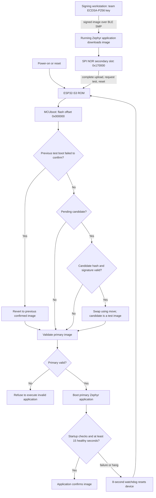

# Firmware Security Implementation — Team 2 回答与评估

[English 提交版](../en/FIRMWARE_SECURITY_CHECKOFF.md) · [GitHub 主分支](https://github.com/ese5180/f26-t02-wearable-buddy-system/tree/main) · [PR #1](https://github.com/ese5180/f26-t02-wearable-buddy-system/pull/1)

在 **2026-10-31 的 3.5 实测**中，T01 与 C01 均运行已确认的 1.1.20。**已在C01既有UART recovery bootloader上重测BLE FOTA**：正常升级、错误签名／损坏拒绝、同文件续传和有效签名故障镜像watchdog回滚通过，见[3.5 实测](../VALIDATION.md#earlier-hardware-validation)。此前UART签名恢复在1.1.19上完成；本轮没有连接外接TTL线。

## 3.5.1 启动与更新流程

电脑使用 Team2 独有 ECDSA-P256 私钥签名，通过 BLE SMP 将镜像交给正在运行的 Zephyr 应用。应用把它写入 secondary，完成后请求 test upgrade 并复位。ESP32-S3 ROM 启动 MCUboot；MCUboot 校验候选镜像哈希与签名，通过后按 swap using move 切换，作为未确认镜像试运行。应用启动 watchdog，检查分区、LoRa 初始化及 SPI 读回、BLE 启动与广播循环。至少15秒健康运行且 heartbeat 开启后自确认；启动失败或广播循环异常不喂狗，8秒 watchdog 复位，未确认试运行镜像由 MCUboot 回滚到此前 confirmed 版本。

健康检查不是所有业务功能的证明：可选 IMU 缺失只报告 UNKNOWN，不阻止镜像确认；已经 confirmed 后才出现的错误，不保证自动按试运行路径回滚。

## Bootloader 与应用大小

下表是**实际二进制文件大小**，不是 RAM 或预留分区大小。已安装镜像的大小保留在[实测摘要](../VALIDATION.md)。

| 部件 | 版本 | 未签名应用／引导程序 | 签名应用 |
|---|---|---:|---:|
| T01 MCUboot | 原 BLE 配置 | 46,672 B，45.58 KiB | 非应用镜像 |
| C01 MCUboot | 启用 UART recovery | 63,728 B，62.23 KiB | 非应用镜像 |
| 儿童标签 T01，含 LSM6DSO | 1.1.20 | 436,948 B，426.71 KiB | 437,099 B，426.85 KiB |
| 辅导员 C01 | 1.1.20 | 435,748 B，425.54 KiB | 435,899 B，425.68 KiB |

Bootloader 预留64 KiB；每个应用槽1,376,256 B（1,344 KiB），含 header／trailer／swap 开销。BLE 上传 `zephyr.signed.bin`，首次 USB 安装另含独立 MCUboot 文件。

## 下载由谁处理？

正常 FOTA **由应用处理下载**：Zephyr MCUmgr image-management 接收 BLE SMP 数据并写入 secondary。MCUboot 负责启动时验证、激活、试运行／回滚及跳转，不负责当前 BLE 下载。已实现的 Extra credit 则由 MCUboot 自己运行 UART SMP 下载入口，在应用启动前或没有有效应用时恢复。

## 为什么选 BLE？

当前通过 **BLE SMP／MCUmgr** 查询镜像、上传、标记试运行及复位。BLE 已用于 presence，Mac 可以在近距离直接更新，不需要 AP、网络凭据或云服务；Zephyr 已有对应 image-management 支持。

3.5 使用 BLE 近距离维护。后续 3.6 新增直连 Wi-Fi OTA，见 [Fleet 指南](FLEET_MANAGEMENT.md)。LoRa 当前仅发12字节监督消息，传约436 KB固件需要另做分片／批量传输协议并占用大量空中时间。选择 BLE 可以完成本阶段近距离维护，同时保留 LoRa 用于告警／查询。当前 SMP 默认244字节包，桌面更新需要几分钟。

## 镜像存在哪里？是否属于 external Flash？

下载镜像存入 XIAO **板载8 MiB外部 SPI NOR Flash** 的 secondary，不在 RAM：

| 区域 | Flash 偏移 | 分配容量 |
|---|---|---|
| MCUboot | `0x000000` | `0x10000` |
| 系统保留 | `0x010000` | `0x10000` |
| Primary，当前应用 | `0x020000` | `0x150000` |
| Secondary，下载候选 | `0x170000` | `0x150000` |

物理 Flash 为8 MiB；当前分区图使用其低4 MiB，表后还有上游保留区，完整布局以生成的 Devicetree 为准。[Seeed 官方原理图](https://files.seeedstudio.com/wiki/SeeedStudio-XIAO-ESP32S3/new-res/202003751_XIAO%20ESP32S3_v1.4_SCH_260226.pdf.pdf)把 U1 ESP32-S3R8 与 U5 GD25Q64ENIGR SPI NOR 列为独立器件，因此从 MCU 芯片边界看是 external Flash。

**目前没有另接第二颗 Flash 模块。**如果课程指 MCU 外部 Flash，上述硬件即为对应存储；如果 Nick 特指独立于启动 Flash 的额外存储器，仍需确认这一要求，不能声称已经接了第二个模块。

## 如何处理更新失败？

| 失败类型 | 已启用机制 | 已有实测 |
|---|---|---|
| 错误签名／密钥 | MCUboot 使用团队公钥做 ECDSA-P256 验证 | 1.3.2完整上传／test／复位后拒绝，原confirmed1.1.20及digest保留 |
| 下载镜像损坏 | 启动前哈希与签名验证 | 损坏1.4.1完整上传后未启动，原confirmed1.1.20保留 |
| 签名有效但试运行代码故障 | test boot、延迟确认、8秒 watchdog、move-swap 回滚 | 1.2.2实际未确认启动故障后回滚confirmed1.1.20 |
| 下载中断 | secondary 暂存，完成前不激活；客户端按同一文件 SHA 续传 | 签名故障1.2.2在87,258 B暂停，原1.1.20保留，同文件从该偏移续传 |
| swap 中复位 | MCUboot 记录交换进度、重启后处理 | 算法已配置；未做 swap 中主动断电实测 |

历史测试保存在[日期对应记录](../VALIDATION.md)。[1.1.20回归](../VALIDATION.md)另在当前C01 bootloader上完成错误签名1.3.2、损坏1.4.1拒绝，有效签名故障1.2.2回滚到1.1.20，以及从87,258字节同文件续传；两端正常BLE更新／自确认通过。**上传成功或bootable字段不能代替复位后的active版本与digest核对。**

## 配置与密钥

- [prj.conf](../../firmware/prj.conf)：MCUboot 应用支持、BLE SMP、image-management、Flash 写入。
- [sysbuild.conf](../../firmware/sysbuild.conf)：MCUboot、ECDSA-P256、swap using move。
- [mcuboot.conf](../../firmware/sysbuild/mcuboot.conf)：`CONFIG_BOOT_VALIDATE_SLOT0=y`、`CONFIG_BOOT_UPGRADE_ONLY=n`，保留验证与回滚。
- [health.c](../../firmware/src/update/health.c)：watchdog 与延迟确认。
- [build.py](../../scripts/build.py)：读取仓库外私钥并验证构建产物。
- [团队公钥](../../keys/team2-signing-public.pem)：Git 中仅保留验证材料。

密钥为 Team2 独有生成，不是 MCUboot 示例密钥，私钥不上传。当前未开启 ESP 硬件 Secure Boot eFuse 或 Flash 加密；已完成的是 MCUboot 应用签名验证，物理 USB 替换引导程序仍属于未锁定路径。管理授权、反降级策略和业务消息认证另待实现。

## Extra credit：UART 恢复实测结果

本节保留同日较早的1.1.19 UART实测；后续1.1.20 BLE回归保留该bootloader，没有重新测试外接UART。

**C01 上已实现并完成演示。**完整命令见 [UART 操作流程](UART_RECOVERY.md)，结果见[日期对应验证](../VALIDATION.md)。

| 项目 | 实测结果 |
|---|---|
| 完整备份、只换 bootloader |8 MiB 备份通过；bootloader 读回匹配，0x10000及之后全部内容保留 |
| 最终 bootloader |63,728 B，原64 KiB分区剩1,808 B |
| 真实 UART |CP2102、1152008N1；D6 TX/GPIO43、D7 RX/GPIO44；XIAO 单独 USB 供电 |
| 正确团队签名 |1.1.19经 MCUboot UART 上传，实际启动为COUNSELOR，confirmed1 |
| 错误密钥签名 |1.3.1通过其测试公钥验证、被团队公钥拒绝；完整 UART 上传后，MCUboot 验证排除 primary，复位不执行它 |
| 无有效应用恢复 |错误镜像复位约33秒后仍能查询 MCUboot，只列出有效 secondary，超过正常入口窗口 |
| 最终恢复 |在没有正常应用／BLE 的状态下再经 UART 上传正确1.1.19；启动、BLE active/confirmed、LoRa SPI0x1424均通过 |

核心文件：[recovery 配置](../../firmware/conf/mcuboot-serial.conf)、[UART overlay](../../firmware/conf/mcuboot-serial.overlay)、[带备份检查的 bootloader 安装脚本](../../scripts/install_recovery_bootloader.py)、[UART 主机工具](../../tools/bg_uart_recovery.py)。固定版本的 ESP32 Xtensa 单线程配置收到了 UART 字节，却没有处理接收中断；构建脚本自动应用一条 [MCUboot Kconfig 默认值修复](../../patches/mcuboot-esp32-uart-threading.patch)，启用多线程。单在配置片段写隐藏符号没有生效。不启用 recovery 的普通构建保留原线程默认值；最终脚本还在新的构建目录完成了签名构建验证。

恢复流程：复位→ESP ROM→MCUboot 验证镜像并检查恢复入口→窗口内收到 SMP 命令或没有有效应用时保持 UART 服务→直接把签名应用写入 primary→复位重新验签→有效则启动应用，无效则继续恢复。

[MCUboot UART 默认写 primary](https://docs.mcuboot.com/serial_recovery.html)，可能覆盖原应用，不能沿用 BLE secondary 暂存／test-swap 的保护承诺。本次正确恢复镜像启动时已经 confirmed，不能把它描述为重新完成了一轮延迟确认或故障回滚。`BOOT_VALIDATE_SLOT0` 负责签名约束，`BOOT_SERIAL_NO_APPLICATION` 保证无应用时仍可恢复。ESP ROM USB 烧录和应用 shell 不等于这个加分功能。

本轮仅连接 C01 与 TTL 模块，没有重跑两板 LoRa／IMU；之前的标签、传感器和无线验证单独保留。串口访问身份认证、硬件 secure-boot eFuse、Flash 加密及防降级尚未实现。没有独立测量此无品牌线的逻辑电压；队友复现请使用有明确3.3V逻辑规格的适配器。
