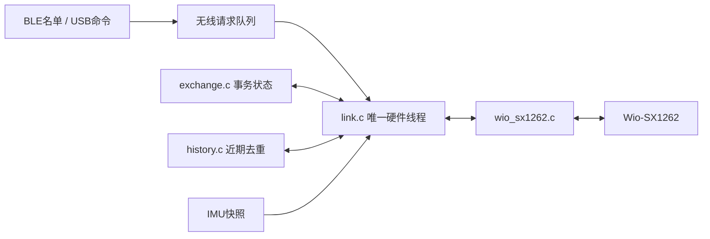

# 无线可靠性与复现：1.1.20

[English](../en/WIRELESS_RELIABILITY.md) · [固件解释](FIRMWARE.md) · [完整环境搭建](GETTING_STARTED.md)

本轮范围是 BLE FOTA 回归与 LoRa 收发可靠性。外接 CP2102／TTL UART 线不需要连接；板载 USB 提供供电和开发命令，FOTA 数据通过 BLE 传输。UART recovery bootloader 保持原样。

## 先按模块理解

| 模块 | 负责什么 | 不负责什么 |
|---|---|---|
| `src/main.c` | 启动顺序、健康循环 | 无线协议细节 |
| `src/drivers/wio_sx1262.c` | 硬件初始化、915 MHz 配置、一次发送／接收 | ACK 重试和业务告警 |
| `src/protocol/wire.c` | 8字节 BLE／12字节 LoRa 编解码和格式检查 | 收发调度 |
| `src/radio/exchange.c` | 单个事务的发送时机、超时、重试、完成匹配 | Zephyr、SPI、日志和休眠 |
| `src/radio/history.c` | 最近16个业务消息的重复检查 | 身份认证或防重放 |
| `src/radio/link.c` | 唯一无线硬件线程、事务队列、所有收包分发、业务日志及 ACK | 直接操作 BLE 或传感器总线 |
| `src/roster/roster.c` | 辅导员 BLE 名单、失联触发查询 | 等待 LoRa 回复 |
| `src/sensors/imu.c` | 独立采样并提供真实运动快照 | 操作 LoRa |
| `src/platform/health.c` | watchdog、正常 BLE 试运行镜像自确认 | 替代完整业务功能验收 |

接口在 `firmware/include/`。先看头文件，再看 `tests/radio_vectors.c`，最后看实现：这样能先理解模块如何使用，再理解内部细节。



## 事务如何运行

- STATUS、SOS、REPLY 等待 ACK，超时600 ms。
- QUERY 等待同一标签、同一序号的 REPLY，超时1500 ms。
- 每个事务最多发送3次，重试保持相同序号；重试前使用由标签与序号计算的短退避。
- 等待和退避都由状态机记录时间，不在嵌套接收循环中等待。200 ms窗口保留底层接收完整包的时间，超时决策可能有一个接收窗口的调度延迟。唯一无线线程继续以200 ms接收窗口分发每一个有效帧。
- 例如辅导员正在等 T01 的 REPLY，此时收到 STATUS：它仍会记录状态并发送 ACK，随后继续等原来的 REPLY。
- 标签等待 STATUS 的 ACK 时收到 QUERY，会保存一个待回复请求，现有事务结束后回复；相同查询的重传会合并。若不同的新查询覆盖尚未处理的回复，会明确记录警告。
- 近期重复业务帧仍会得到 ACK，但不重复触发业务事件；历史只保留16项，不是安全防重放。设备重启复用近期序号时，在记录淘汰前仍可能被判为重复，需要后续带会话标识的协议可靠区分。

帧仍为协议1、12字节。ACK 的 byte5 原为保留字节，现在可填写被确认的消息类型；新固件会检查它，同时接受旧固件的 byte5=0 ACK，便于逐台升级。旧 ACK 的消息类型匹配能力较弱。广播标识、消息认证及防降级策略没有在本轮改变。

`bg radio` 显示启动以来的计数：发送次数、完成／耗尽、有效收包、事务等待期间分发的其他消息、重复业务帧、QUERY／REPLY 和队列溢出。每个计数原子读取，整组快照不是同一个精确时刻。应用复位后清零。

## 构建与升级

按完整操作文档建立环境并准备原团队密钥。在仓库根目录设置自己的路径与端口：

```sh
BG_WS="$HOME/buddyguard-workspace"
BG_KEY="$HOME/.config/buddyguard/team2-signing/firmware-ecdsa-p256.pem"
C01=/dev/cu.usbmodem101
T01=/dev/cu.usbmodem1101
.venv/bin/python -m serial.tools.list_ports -v
.venv/bin/python -m unittest discover -s tests -v
"$BG_WS/.venv/bin/python" scripts/build.py --workspace "$BG_WS" --key "$BG_KEY" \
  --build-dir "$BG_WS/build-radio20-c01" --role counselor --serial-recovery --version 1.1.20
"$BG_WS/.venv/bin/python" scripts/build.py --workspace "$BG_WS" --key "$BG_KEY" \
  --build-dir "$BG_WS/build-radio20-t01" --role tag --tag-id 1 --imu --version 1.1.20
```

先用 `bg status` 核对端口角色，不能只凭端口数字。辅导员的 `--serial-recovery` 是复现对应构建配置；以下 BLE 升级只传应用，不会重写已安装的 bootloader。此处不要使用首次整片烧录脚本。

```sh
.venv/bin/python tools/bg_serial.py --port "$C01" command bg maintenance 600
.venv/bin/python tools/bg_ble.py --name BG-C01 update "$BG_WS/build-radio20-c01/firmware/zephyr/zephyr.signed.bin"
.venv/bin/python tools/bg_serial.py --port "$C01" command bg status
.venv/bin/python tools/bg_ble.py --name BG-C01 images
.venv/bin/python tools/bg_serial.py --port "$T01" command bg maintenance 600
.venv/bin/python tools/bg_ble.py --name BG-T01 update "$BG_WS/build-radio20-t01/firmware/zephyr/zephyr.signed.bin"
```

升级后等待正常启动与至少15秒健康窗口，确认实际版本、角色、`confirmed=1` 和 SMP 的 active/confirmed 镜像。若要看到启动及确认过程，应在另一个终端提前运行 USB monitor。

```sh
.venv/bin/python tools/bg_serial.py --port "$C01" --log evidence/raw/my-c01.log monitor --seconds 600
```

同一个端口只保留一个读取程序。已有 monitor 时，发命令请加 `command --no-read`：只写入，不清空接收缓冲、不争抢日志。例如：

```sh
.venv/bin/python tools/bg_serial.py --port "$C01" command --no-read bg query 1
```

没有独立 monitor 时，正常使用 `command bg ...` 查看回复。

## 无线复现顺序

1. 两端 `bg status`，标签 `bg imu`；确认真实采样、正确角色和版本。
2. 两端 `bg maintenance 0`，确认辅导员持续看到新心跳序号。
3. 辅导员 `bg query 1`：日志应显示 QUERY 发送、同序号 REPLY、QUERY complete；标签收到 ACK。
4. 标签 `bg sos`：辅导员记录一次 ACTION，标签完成 ACK 事务。
5. 辅导员 `bg query 2`（仅 T01 存在时）：应有限重发3次后报告未确认，不能永久阻塞 T01 的 STATUS／SOS 处理。
6. 标签 `bg heartbeat off`：触发 BLE MISSING 和自动查询；`bg heartbeat on` 后出现 RECOVERED。这只停止 BLE 广播，LoRa 仍在运行，不代表完全断电。
7. 查询两端 `bg radio`，对照日志解释重试／耗尽／交错收包；不能把三个发送都未确认解释为儿童必然失踪。

建议做30分钟连续运行测试；这是建议的台架验收长度，不是覆盖范围或儿童安全可靠性认证。实测结果应单独记录，不能由测试计划推断已经通过。

## FOTA 回归与安全测试

正常无线升级与 UART 覆盖 primary 的恢复是两条不同路径。新 recovery bootloader 安装后，需要重新验证 BLE 正常升级、自确认、错误签名／损坏拒绝，以及有效签名的故障试运行镜像回滚。

负面镜像始终构建为辅导员角色，只经 BLE 写入 secondary，不安装它们的 MCUboot。保留正确签名1.1.20用于恢复。具体签名根、存储地址、watchdog及验收标准见[安全实现文档](FIRMWARE_SECURITY_CHECKOFF.md)。不要用手工 `confirm=True` 掩盖健康确认失败。

### 可直接重复的 BLE 负面测试

以下步骤假设 C01 已经运行并确认正确的1.1.20，USB monitor 已在另一个终端记录日志。每次测试之间，等前一个 BLE 客户端完全退出，并核对正确 primary 后再开始下一项。

在仓库外建立一次测试密钥，不能覆盖原团队签名密钥：

```sh
BG_BAD_KEY="$HOME/.config/buddyguard/team2-signing/wrong-key-test.pem"
if [ ! -f "$BG_BAD_KEY" ]; then
  "$BG_WS/.venv/bin/imgtool" keygen -k "$BG_BAD_KEY" -t ecdsa-p256
fi
chmod 600 "$BG_BAD_KEY"
"$BG_WS/.venv/bin/python" scripts/build.py --workspace "$BG_WS" --key "$BG_BAD_KEY" \
  --build-dir "$BG_WS/build-radio20-wrong" --role counselor --version 1.3.2
"$BG_WS/.venv/bin/python" scripts/build.py --workspace "$BG_WS" --key "$BG_KEY" \
  --build-dir "$BG_WS/build-radio20-corrupt-source" --role counselor --version 1.4.1
"$BG_WS/.venv/bin/python" scripts/build.py --workspace "$BG_WS" --key "$BG_KEY" \
  --build-dir "$BG_WS/build-radio20-fault" --role counselor --fault --version 1.2.2
```

这些构建生成的 bootloader **全部不安装**。只经 BLE 传它们的 `firmware/zephyr/zephyr.signed.bin`。

错误根测试：先用团队公钥离线验证，应拒绝；再经 BLE 上传到 secondary，允许设备在启动时拒绝：

```sh
"$BG_WS/.venv/bin/imgtool" verify -k keys/team2-signing-public.pem "$BG_WS/build-radio20-wrong/firmware/zephyr/zephyr.signed.bin"
.venv/bin/python tools/bg_serial.py --port "$C01" command --no-read bg maintenance 600
.venv/bin/python tools/bg_ble.py --name BG-C01 update "$BG_WS/build-radio20-wrong/firmware/zephyr/zephyr.signed.bin"
# 等USB日志显示正确1.1.20重新启动，再查询：
.venv/bin/python tools/bg_ble.py --name BG-C01 images
```

损坏测试：复制单独的1.4.1镜像，仅破坏副本的签名覆盖数据，保留原文件：

```sh
.venv/bin/python - "$BG_WS/build-radio20-corrupt-source/firmware/zephyr/zephyr.signed.bin" "$BG_WS/corrupt-1.4.1.signed.bin" <<'PY'
from pathlib import Path
import sys
source, target = map(Path, sys.argv[1:])
assert not target.exists(), 'Preserve previous test artifacts; choose a new target.'
data = bytearray(source.read_bytes())
data[0x400] ^= 1
target.write_bytes(data)
PY
"$BG_WS/.venv/bin/imgtool" verify -k keys/team2-signing-public.pem "$BG_WS/corrupt-1.4.1.signed.bin"
.venv/bin/python tools/bg_serial.py --port "$C01" command --no-read bg maintenance 600
.venv/bin/python tools/bg_ble.py --name BG-C01 update "$BG_WS/corrupt-1.4.1.signed.bin"
# 等USB日志显示正确1.1.20重新启动，再查询images。
```

上面两次离线 verify 返回失败是预期结果。BLE 上传成功不代表设备接受签名：最终必须核对 active版本仍为1.1.20、confirmed=true、镜像digest与原正确版本一致。

有效签名故障镜像，同时演示中断／续传：

```sh
.venv/bin/python tools/bg_serial.py --port "$C01" command --no-read bg maintenance 600
.venv/bin/python tools/bg_ble.py --name BG-C01 upload "$BG_WS/build-radio20-fault/firmware/zephyr/zephyr.signed.bin" --stop-at 20
.venv/bin/python tools/bg_ble.py --name BG-C01 images
.venv/bin/python tools/bg_ble.py --name BG-C01 update "$BG_WS/build-radio20-fault/firmware/zephyr/zephyr.signed.bin"
```

必须是同一个文件：续传应从非零偏移开始。20%暂停后原 primary 应保持 active/confirmed；完成并请求 test 后，1.2.2会实际启动为未确认镜像，打印故障标志，停止喂狗，然后 watchdog 复位、MCUboot 回退到原1.1.20。只有“故障镜像确实启动→WDT复位→正确镜像恢复”三项都观察到，才算回滚通过。最终恢复心跳、关闭维护窗口并核对两端版本。

测试结束后可清理 C01 的 inactive secondary，避免留下故障候选：

```sh
.venv/bin/python tools/bg_ble.py --name BG-C01 erase-secondary
```

工具要求唯一 active 镜像是已确认的 primary，且没有 pending 激活；只允许擦除 slot1，不提供擦除 primary 的参数。整槽擦除时 BLE 回复可能丢失，工具只重连读回，不盲目重复擦除；核对 primary 的版本／digest 不变且 secondary 候选不再列出后才报告成功。这里核对的是 MCUmgr 镜像状态，没有逐字节读回整个分区，也不宣称安全擦除。如果读回不符合条件，会报错，不能自行认定成功。

## 重复本轮五分钟正常模式检查

只连接T01与C01，先核对版本／角色／确认状态，并分别启动USB monitor。以下脚本按15秒间隔安排20次T01查询、8次SOS，另对不存在的T02查询一次。它只安排真实设备命令，不伪造数据或自行宣称通过；对照日志统计完成事件、重试／耗尽和前后计数差值。

```sh
.venv/bin/python - "$C01" "$T01" <<'PYTHON'
import subprocess, sys, time
counselor, tag = sys.argv[1:]
def send(port, *words):
    subprocess.run([sys.executable, 'tools/bg_serial.py', '--port', port,
                    'command', '--no-read', *words], check=True,
                   stdout=subprocess.DEVNULL)
for port in (counselor, tag):
    send(port, 'bg', 'heartbeat', 'on')
    send(port, 'bg', 'maintenance', '0')
time.sleep(4)
for port in (counselor, tag):
    send(port, 'bg', 'radio')
start = time.monotonic()
for i in range(20):
    time.sleep(max(0, start + i * 15 - time.monotonic()))
    if i == 1:
        send(counselor, 'bg', 'query', '2')
    send(counselor, 'bg', 'query', '1')
    if i % 3 == 0 or i == 1:
        send(tag, 'bg', 'sos')
time.sleep(max(0, start + 300 - time.monotonic()))
for port in (counselor, tag):
    send(port, 'bg', 'radio')
    send(port, 'bg', 'status')
send(tag, 'bg', 'imu')
PYTHON
```

本轮实测为20/20查询完成、8/8 SOS收到，无意外复位／失联／队列溢出；链路发生了重试。五分钟结果不能代替完整30分钟、户外范围或三标签并发验证。
